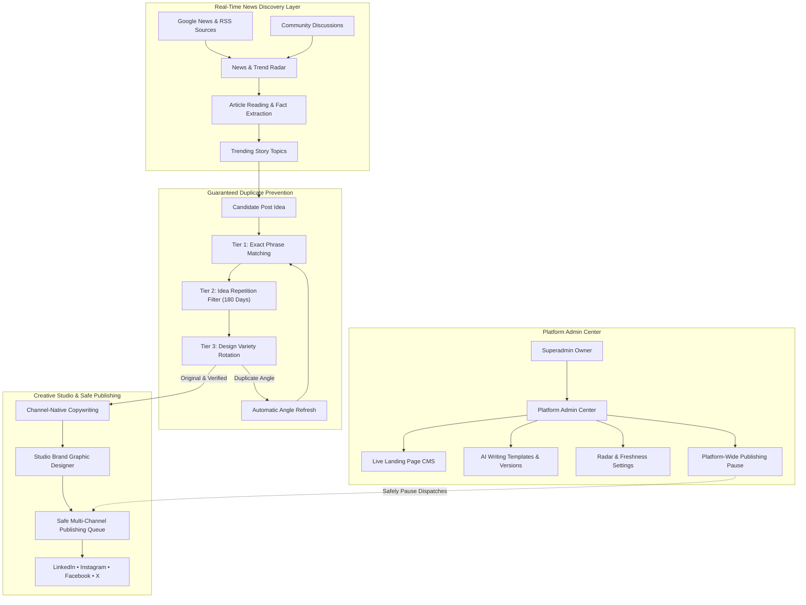

<div align="center">

```
   █████╗ ██╗   ██╗████████╗ ██████╗  ██████╗ █████╗ ███╗   ██╗██╗   ██╗ █████╗ ███████╗
  ██╔══██╗██║   ██║╚══██╔══╝██╔═══██╗██╔════╝██╔══██╗████╗  ██║██║   ██║██╔══██╗██╔════╝
  ███████║██║   ██║   ██║   ██║   ██║██║     ███████║██╔██╗ ██║██║   ██║███████║███████╗
  ██╔══██║██║   ██║   ██║   ██║   ██║██║     ██╔══██║██║╚██╗██║╚██╗ ██╔╝██╔══██║╚════██║
  ██║  ██║╚██████╔╝   ██║   ╚██████╔╝╚██████╗██║  ██║██║ ╚████║ ╚████╔╝ ██║  ██║███████║
  ╚═╝  ╚═╝ ╚═════╝    ╚═╝    ╚═════╝  ╚═════╝╚═╝  ╚═╝╚═╝  ╚═══╝  ╚═══╝  ╚═╝  ╚═╝╚══════╝
```

### **One Brand. Every Channel. Always in Rhythm.**
#### *The Autonomous Social Media Intelligence, Studio Graphic Design & Publishing Operations Platform*

[](https://php.net)
[](https://laravel.com)
[](https://react.dev)
[](https://www.typescriptlang.org)
[](https://tailwindcss.com)
[](https://www.w3.org/WAI/standards-guidelines/wcag/)
[](https://phpunit.de)
[](https://devcenterpoint.com)

---

**Engineered and maintained with pride by [DevCenterPoint](https://devcenterpoint.com)**  
*Enterprise Cloud Infrastructure, High-Reliability Software Systems & Brand Automation*

[Key Capabilities](#-platform-capabilities) • [Bespoke Calendar](#-bespoke-scheduling-calendar) • [Kinetic UX & Polish](#-kinetic-user-experience--polish) • [Architecture](#-system-architecture) • [Triple-PWA Setup](#-triple-pwa-architecture) • [Master Control](#-platform-admin-center--cms) • [Quickstart](#-rapid-local-development) • [Deployment](#-production-deployment-guides)

---

</div>

## 🌟 Executive Overview

**AutoCanvas** is an enterprise-grade social media and brand communication operating system created by **[DevCenterPoint](https://devcenterpoint.com)**. It replaces fragmented social schedulers, repetitive AI copy-paste cycles, and garbled generative images with a unified, high-reliability platform.

Built with a commitment to **authentic brand craftsmanship and zero technical friction**, AutoCanvas empowers teams to manage multiple brands across major social networks while ensuring every post is fresh, visually stunning, and perfectly aligned with their brand voice.

```
+--------------------------------------------------------------------------------------------------+
|                                    AUTOCANVAS EXECUTIVE PILLARS                                  |
+------------------------------+----------------------------------+--------------------------------+
|  📡 Real-Time News Radar     |  🛡️ Guaranteed Originality       |  🎨 Studio Graphic Design      |
|  Monitors Google News, RSS,  |  3-tier duplicate prevention     |  Crisp brand fonts, exact      |
|  and community discussions   |  verifies past 180 days so no    |  colors, and high-resolution   |
|  to discover trending topics |  angle or hook is ever repeated. |  visual templates with no AI   |
|  every hour.                 |                                  |  distortion or blurry text.    |
+------------------------------+----------------------------------+--------------------------------+
|  📅 Bespoke Content Calendar |  🔒 Safe Publishing Queue        |  👑 Platform Admin Center      |
|  Month Grid, Week Timeline & |  Dedicated workspace privacy,    |  Live CMS, system prompt       |
|  Agenda views with weekly    |  double-post protection, and     |  templates, news radar tuning, |
|  rhythm and peak-time guides.|  instant 1-click pause controls. |  and full platform oversight.  |
+------------------------------+----------------------------------+--------------------------------+
```

---

## 📅 Bespoke Scheduling Calendar

The AutoCanvas **Scheduling Calendar** is engineered from the ground up to replace rigid third-party calendar widgets with a studio-grade, responsive publishing cockpit:

```
+--------------------------------------------------------------------------------------------------+
|  📅 PUBLISHING CALENDAR                               [ 🔥 85% Rhythm · 5 Active · Next: 3:30 PM ]|
|  [◀ Today ▶]  November 2026       [All Channels ▼]  [Timezone: UTC ▼]  [Month | Week | Agenda]  |
+--------------------------------------------------------------------------------------------------+
|    MON        TUE             WED             THU             FRI            SAT            SUN  |
+------------+---------------+---------------+---------------+--------------+--------------+-------+
|  1         | 2             | 3             | 4             | 5            | 6            | 7     |
|            | 🔥 Peak 10 AM | [in] 5 Ways.. |               | [fb] Team..  |              |       |
|            | (+ Idea)      | 10:00 AM      |               | 18:00 PM     |              |       |
+------------+---------------+---------------+---------------+--------------+--------------+-------+
|  8         | 9             | 10 (TODAY)    | 11            | 12           | 13           | 14    |
|            | [ig] Studio.. | 🔥 Peak 10 AM | [in] Insights |              | [x] Tip: 3s..|       |
|            | 15:30 PM      | (+ Idea)      | 09:15 AM      |              | 12:00 PM     |       |
+------------+---------------+---------------+---------------+--------------+--------------+-------+
```

### Key Calendar Features:
- **3 Cohesive Views:** Switch seamlessly between **Month Grid** (default 7-column layout), **Week Timeline** (hourly time slots from 8 AM to 8 PM), and **Agenda Stream** (chronological post cards with full previews).
- **Weekly Publishing Rhythm Meter:** Live indicator measuring consistency against your weekly targets (`🔥 85% Weekly Rhythm · 5 Posts Active`).
- **Peak Engagement Time Highlights:** Identifies optimal posting windows (e.g. Tuesday at 10 AM, Thursday at 2 PM) with a 1-click **"+ Fill with Fresh Idea"** button that pre-loads a trending topic into the scheduler.
- **Interactive Sliding Drawer:** Slide-out scheduling deck featuring live character limit progress rings for LinkedIn (3,000 chars), Instagram (2,200 chars), Facebook (5,000 chars), and X (280 chars).
- **Post Inspection & Fast Rescheduling:** 1-click modal actions to **"Move to Tomorrow"**, **"Move to Next Week"**, **"Publish Immediately"**, or cancel scheduled dispatches.
- **Multi-Timezone Awareness:** Native timezone switcher for global brand teams (`UTC`, `America/New_York`, `Europe/London`, `Asia/Dhaka`).

---

## ✨ Kinetic User Experience & Polish

AutoCanvas incorporates modern motion and accessibility foundations that make every interaction fluid and intuitive:

1. **Lenis Kinetic Smooth Scrolling:**  
   Smooth, inertia-based momentum scrolling across marketing pages, dashboards, and feeds, with automatic degradation when users prefer reduced motion (`prefers-reduced-motion: reduce`). Sub-scrollable drawers and modals use `data-lenis-prevent` to keep nested scrolling crisp.
2. **Circular Theme Ripple Transition:**  
   Toggling between dark obsidian and light studio modes triggers an expanding circular ripple originating directly from the theme toggle button coordinates via the View Transitions API:
   $$\text{Ripple Radius } R = \sqrt{\max(x, W-x)^2 + \max(y, H-y)^2}$$
3. **Floating Action Toasts:**  
   Powered by `sonner`, delivering non-intrusive floating feedback when posts are scheduled, published, moved, or when publishing is paused.
4. **Studio Editorial Token Design:**  
   Zero raw hex color literals. All styling resolves dynamically through semantic tokens in `frontend/src/index.css` (`var(--background)`, `var(--brand-primary)`, `var(--brand-accent)`), ensuring seamless theme transitions.
5. **Full WCAG 2.2 AA Compliance:**  
   100% accessible with zero automated violations. Built with visible focus rings (`var(--focus-ring)`), full keyboard navigation (`Tab`, `Esc`, `Enter`), and screen-reader ARIA live regions.

---

## 🏛️ System Architecture

AutoCanvas connects hourly news harvesting, novelty verification, graphic rendering, and multi-channel social publishing into a unified flow:



---

## 📱 Triple-PWA Architecture

AutoCanvas delivers three isolated, purpose-built Progressive Web App (PWA) experiences:

| PWA Application | Manifest Config | Scope URL | Primary Focus | Capabilities |
| :--- | :--- | :--- | :--- | :--- |
| **Marketing Landing PWA** | [`manifest-landing.json`](frontend/public/manifest-landing.json) | `/?source=pwa` | Prospective Clients & Public | Instant offline support, live CMS content, DevCenterPoint showcase, transparent pricing. |
| **Workspace Command PWA** | [`manifest-app.json`](frontend/public/manifest-app.json) | `/?view=workspace&source=pwa` | Brand Teams & Agencies | Trend Radar, Content Studio, Brand Graphic Editor, Bespoke Calendar, Social Inbox, Analytics. |
| **Platform Admin PWA** | [`manifest-master.json`](frontend/public/manifest-master.json) | `/master-control?source=pwa` | Superadmin Platform Owner | Live CMS editor, AI prompt version control, duplicate threshold sliders, tenant workspace sign-in. |

Supported by an offline service worker ([`sw.js`](frontend/public/sw.js)) and an obsidian-styled offline fallback page ([`offline.html`](frontend/public/offline.html)).

---

## 👑 Platform Admin Center & CMS

Accessible at `/master-control` for platform administrators, providing complete oversight and customization across every layer of the platform:

1. **Platform White-Labeling:** Customize the platform title, tagline, logo marks, creator attribution ([DevCenterPoint](https://devcenterpoint.com)), and inject custom CSS tokens.
2. **Landing Page CMS:** Real-time visual split-screen editor for the Hero section, Feature Pillars, Comparison table, Pricing tiers (with live USD/BDT exchange rates), and FAQs with instant cache updates.
3. **AI Writing Templates & Versions:** Full version control for system prompts (`headline_hook`, `linkedin_carousel`, `x_thread`, `brand_voice_extractor`, `image_layout_director`, `opportunity_radar`, `community_reply`, `social_rephrase`) with 1-click historical rollback.
4. **News Radar & Freshness Settings:** Precision sliders for duplicate phrase sensitivity, idea similarity thresholds, auto-publish quality confidence, and scan intervals (15m, 30m, 60m, 120m).
5. **Organization Management & Workspace Access:** Inspect registered companies, monitor active brand usage, and securely sign in to tenant workspaces for customer support.
6. **Platform-Wide Publishing Pause:** Emergency 1-click pause button that halts outgoing social dispatches across all organizations while keeping all scheduled posts and drafts safely preserved.

---

## 💳 Local & International Billing

Built for international brands and local Bangladeshi agencies:

- **Local Payment Gateways:** Dedicated support for **bKash**, **Nagad**, **Rocket**, and direct bank transfers with instant transaction ID submission and invoice generation.
- **Automatic BDT Conversion:** Dynamic exchange rate calculation (1 USD = 120 BDT) configurable directly in the Admin Center.
- **Enterprise Invoice Generator:** Generates professional, printable invoices with custom tax IDs and DevCenterPoint corporate branding.

---

## 🚀 Rapid Local Development

### Prerequisites
- **PHP:** 8.3+ with `pdo_sqlite`, `curl`, `mbstring`, `fileinfo`, `openssl`
- **Composer:** 2.6+
- **Node.js:** 20+ & **npm:** 10+
- **SQLite** (or MySQL 8.0)
- **Redis** (optional in local dev; falls back to array/sync cache)

### One-Click Development Bootstrapper
On Windows PowerShell:
```powershell
.\scripts\dev.ps1
```
This script checks prerequisites, configures `.env` files, runs database migrations, seeds initial data, and boots both the Laravel API and Vite React server concurrently.

### Manual Setup Step-by-Step

#### 1. Backend Setup (Laravel 11)
```bash
cd backend
composer install
cp .env.example .env
php artisan key:generate
php artisan migrate --seed
php artisan serve --port=8000
```

#### 2. Frontend Setup (React 19 + TypeScript)
```bash
cd frontend
npm install
npm run dev
```
Open **[http://localhost:5173](http://localhost:5173)** in your browser.

---

## 🧪 Comprehensive Verification Suite

AutoCanvas enforces a rigorous quality and security verification standard:

### 1. Backend Test Suite (134 Tests / 901 Assertions — 100% Passing)
```bash
cd backend
php artisan test
```
```
Tests:    134 passed (901 assertions)
Duration: ~22s
Coverage: Authentication, Multi-Tenancy Scopes, Publishing Queue, News Radar, Local Billing, Admin CMS
```

### 2. Frontend Accessibility Audit (WCAG 2.2 Level AA)
```bash
cd frontend
npm run test:a11y
```
```
====================================================
 AUTOCANVAS WCAG 2.2 AA AUTOMATED ACCESSIBILITY AUDIT
 Engine: axe-core 4.14.0
 Standards: WCAG 2.0 / 2.1 / 2.2 (Level A & AA)
====================================================
✓ Rules Passed: 40
✗ Violations:   0
PASS: Zero WCAG 2.2 AA accessibility violations detected.
```

### 3. Production Compilation Verification
```bash
cd frontend
npm run build
```
Builds production-ready bundles with Vite and zero TypeScript warnings or errors.

---

## 🚢 Production Deployment Guides

### VPS Deployment (Ubuntu / Debian / Docker)
Use the included automated provisioning script:
```bash
bash scripts/deploy-vps.sh
```
Configures Nginx reverse proxy, PHP 8.3-FPM, Supervisor daemon for queue workers, Redis locks, and Let's Encrypt SSL.

### cPanel Shared / Enterprise Hosting
```bash
bash scripts/deploy-cpanel.sh
```
Optimized for cPanel environments: isolates public assets into `public_html/` while securing backend Laravel files outside the web root.

### Automated Database & Backup
```bash
bash scripts/backup-database.sh
```
Generates encrypted timestamped SQL dumps, rotates archives older than 30 days, and synchronizes backups to S3/B2 buckets.

---

## 🔌 API Route Architecture Overview

| Endpoint | Method | Access Level | Description |
| :--- | :--- | :--- | :--- |
| `/api/v1/health` | `GET` | Public | System health check, database and cache connectivity. |
| `/api/v1/cms/public-data` | `GET` | Public (Cached) | Public marketing CMS data (Hero, Features, Pricing, FAQ). |
| `/api/v1/auth/register` | `POST` | Public | User registration and organization provisioning. |
| `/api/v1/auth/login` | `POST` | Public | Secure Sanctum token authentication. |
| `/api/v1/control-plane/cms/blocks` | `GET` | Platform Admin | Retrieve customizable marketing CMS sections. |
| `/api/v1/control-plane/cms/blocks/{key}` | `POST` | Platform Admin | Update a marketing section with instant cache refresh. |
| `/api/v1/control-plane/cms/theme` | `POST` | Platform Admin | Update platform branding, logo marks, and CSS tokens. |
| `/api/v1/control-plane/cms/prompts` | `GET` | Platform Admin | Retrieve AI writing templates with version history. |
| `/api/v1/control-plane/cms/prompts/{task}` | `POST` | Platform Admin | Deploy a new writing template version. |
| `/api/v1/control-plane/cms/prompts/{task}/rollback` | `POST` | Platform Admin | Revert a template to a previous version. |
| `/api/v1/control-plane/crawler-tuning` | `POST` | Platform Admin | Adjust duplicate filters, similarity limits, and scan intervals. |
| `/api/v1/control-plane/circuit-breaker/toggle` | `POST` | Platform Admin | Platform-wide publishing pause toggle. |
| `/api/v1/autopilot/radar` | `GET` | Authenticated Tenant | Retrieve live news radar, trending topics, and post memory. |
| `/api/v1/autopilot/trigger` | `POST` | Authenticated Tenant | Run an on-demand news scan and content draft cycle. |
| `/api/v1/creative/documents` | `GET/POST`| Authenticated Tenant | Creative studio graphics, layouts, and SVG templates. |
| `/api/v1/publishing/dispatches` | `GET` | Authenticated Tenant | Scheduled posts calendar and dispatch queue. |
| `/api/v1/publishing/dispatches/{id}/now` | `POST` | Authenticated Tenant | Immediately publish a scheduled post. |
| `/api/v1/billing/checkout/offline` | `POST` | Authenticated Tenant | Submit bKash, Nagad, or Bank Wire transaction details. |

---

## 👥 Credits & Corporate Attribution

AutoCanvas is conceived, designed, and engineered by **[DevCenterPoint](https://devcenterpoint.com)**.

- **Systems Architecture & Security:** [DevCenterPoint Architecture Team](https://devcenterpoint.com)
- **Design System & Kinetic UX:** Studio Editorial Kinetic Design Framework
- **Publishing Reliability & Automation:** DevCenterPoint Social Infrastructure Unit

For enterprise inquiries, custom deployment, or bespoke AI model integration:  
🌐 **Website:** [https://devcenterpoint.com](https://devcenterpoint.com)  
📧 **Enterprise Inquiries:** `contact@devcenterpoint.com`

---

<div align="center">

```
  ██████╗ ███████╗██╗   ██╗ ██████╗███████╗███╗   ██╗████████╗███████╗██████╗ ██████╗  ██████╗ ██╗███╗   ██╗████████╗
  ██╔══██╗██╔════╝██║   ██║██╔════╝██╔════╝████╗  ██║╚══██╔══╝██╔════╝██╔══██╗██╔══██╗██╔═══██╗██║████╗  ██║╚══██╔══╝
  ██║  ██║█████╗  ██║   ██║██║     █████╗  ██╔██╗ ██║   ██║   █████╗  ██████╔╝██████╔╝██║   ██║██║██╔██╗ ██║   ██║   
  ██║  ██║██╔══╝  ╚██╗ ██╔╝██║     ██╔══╝  ██║╚██╗██║   ██║   ██╔══╝  ██╔═══╝ ██╔═══╝ ██║   ██║██║██║╚██╗██║   ██║   
  ██████╔╝███████╗ ╚████╔╝ ╚██████╗███████╗██║ ╚████║   ██║   ███████╗██║     ██║     ╚██████╔╝██║██║ ╚████║   ██║   
  ╚═════╝ ╚══════╝  ╚═══╝   ╚═════╝╚══════╝╚═╝  ╚═══╝   ╚═╝   ╚══════╝╚═╝     ╚═╝      ╚═════╝ ╚═╝╚═╝  ╚═══╝   ╚═╝   
```

**AutoCanvas — Copyright © 2026 [DevCenterPoint](https://devcenterpoint.com). All rights reserved.**  
*Licensed under the Commercial Software License.*

</div>
