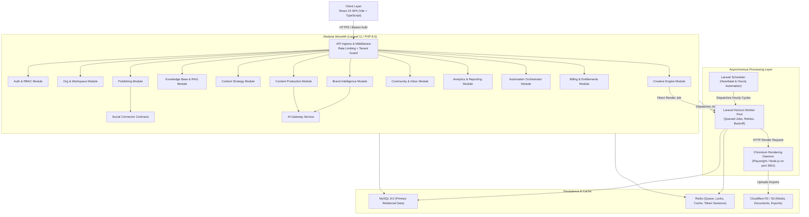
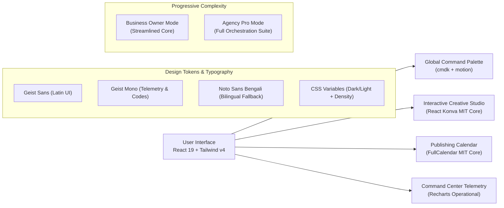

# AutoCanvas — System Architecture Specification
**Version:** 1.0.0 | **Author:** Principal Software Architect | **Date:** 2026-11-10

---

## 1. Architectural Philosophy: The Modular Monolith

AutoCanvas is architected as a **multi-tenant modular monolith** with independent asynchronous worker pools. 

---

## 2. Core Domain Boundaries & Modules

Every domain module under `backend/app/Modules/` is strictly encapsulated:
- **Controllers:** Handle HTTP request validation, call Services, return API Resources.
- **Services:** Execute core domain logic, enforce policy boundaries, dispatch domain events.
- **Models:** Eloquent entities using `HasTenantScope` and `HasUlid`.
- **DTOs:** Strongly-typed data transfer objects between modules and external boundaries.
- **Policies:** Server-side authorization checks using Laravel Gates & Policies.

### The 14 Product Modules:
1. **Auth & Identity:** Registration, login, Sanctum tokens, 2FA, session revocation.
2. **Organization & Workspace:** Tenancy hierarchy (`Organization -> Workspace -> Brand -> Accounts`).
3. **Brand Intelligence:** Brand identity, visual guide, voice, personas, memory entries.
4. **Knowledge Base:** Multi-format ingestion (PDF, DOCX, URLs), chunking, embeddings.
5. **Research & Trends:** News aggregation, RSS feeds, competitor observations, opportunity detection.
6. **Content Strategy:** Content pillars, campaigns, strategic calendar generation.
7. **Content Production:** Concept generation, platform variants, risk classification, QA score.
8. **Creative Engine:** Template catalog, layout composition, rendering queue dispatch, visual QA.
9. **Social Connectors:** OAuth handshakes, capability discovery, token refresh, API client drivers.
10. **Publishing:** Idempotent scheduling, distributed locks, retry backoffs, confirmation checks.
11. **Community Management:** Unified inbox, sentiment classification, assisted/autonomous replies.
12. **Analytics & Intelligence:** Cross-platform metric ingestion, normalized schemas, AI insights.
13. **Automation Orchestrator:** Hourly brand planning cycle, safety bounds, pause controls.
14. **Billing & Entitlements:** Stripe/paddle webhooks, feature gating, token usage metering.

---

## 3. Communication Patterns

- **In-Process Monolith Calls:** Modules invoke public service methods of other modules through explicit typed DTOs.
- **Event-Driven Workflows:** Asynchronous transitions (e.g. `ContentApproved`, `PublishingSucceeded`) fire Laravel Events listened to by Queued Listeners.
- **Micro-Daemon Rendering:** The rendering engine operates as a separate Node.js service communicating over a local HTTP interface to protect PHP worker memory.

---

## 4. Frontend Design Architecture & UI/UX Stack

AutoCanvas avoids generic "AI UI" templates by adhering to an **Industrial Kinetic / Editorial Studio Operations** design stance supported by verified design intelligence:

### Permissive Component & Toolkit Stack:
- **Primitives**: `shadcn/ui` + `Radix UI` accessible headless components (Dialog, Tooltip, Dropdown Menu).
- **Styling**: `Tailwind CSS v4` with theme CSS variables (`data-theme="dark|light"`, `data-density="comfortable|compact"`).
- **Iconography**: `Lucide React` for restrained, consistent operational iconography.
- **Motion**: `Motion for React` (`motion`) for purposeful entrance sequences and modal transitions.
- **Creative Canvas**: `React Konva` (MIT Core), strictly avoiding `tldraw` commercial licensing fees.
- **Publishing Calendar**: `FullCalendar` MIT Core (`dayGridMonth`), avoiding proprietary premium scheduler modules.
- **Data Grids**: `TanStack Table` for information-dense publishing queues and audit trails.
- **Telemetry**: `Recharts` for live publishing cadence and channel engagement visualization.
- **Command Interface**: `cmdk` mounted globally with `⌘K` / `Ctrl+K`.

### Typography Standard:
- **Primary Latin**: `Geist Sans` (SIL Open Font License)
- **Technical Metadata**: `Geist Mono` (SIL Open Font License)
- **Multilingual Support**: `Noto Sans Bengali` (SIL Open Font License)

