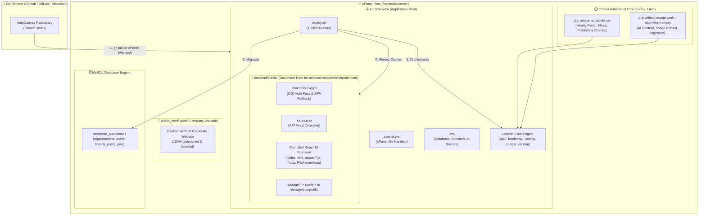

# 🚀 AutoCanvas — Production cPanel Deployment Manual

> **Architectural Blueprint & Step-by-Step Operator Guide**  
> *Target Domain:* `https://autocanvas.devcenterpoint.com`  
> *cPanel User:* `/home/devcente/`  
> *Application Root:* `/home/devcente/AutoCanvas/`  
> *Main Corporate Site:* `https://devcenterpoint.com` (occupies `/home/devcente/public_html/` — untouched)  
> *Deployment Method:* **Git Version Control with Automated 1-Click Script (`./deploy.sh` & `.cpanel.yml`)**  
> *Stack:* cPanel / Apache / PHP 8.3 / MySQL 8.x or MariaDB 10.x / React 19 + TypeScript / Laravel 12  
> *Node.js Dependency on Server:* **Zero (Pre-compiled `frontend/dist` and `backend/public` assets tracked in Git)**

---

## 📑 Table of Contents
1. [Overview & 1-Click Deployment Workflow](#1-overview--1-click-deployment-workflow)
2. [Architecture Topology Diagram](#2-architecture-topology-diagram)
3. [Step 1: Subdomain Setup in cPanel](#step-1-subdomain-setup-in-cpanel)
4. [Step 2: Database Provisioning (MySQL / MariaDB)](#step-2-database-provisioning-mysql--mariadb)
5. [Step 3: Initial Git Clone & One-Time Setup](#step-3-initial-git-clone--one-time-setup)
6. [Step 4: Automated 1-Click Deployments](#step-4-automated-1-click-deployments)
   - [Method A: Terminal Command (`./deploy.sh`)](#method-a-terminal-command-deploysh)
   - [Method B: cPanel Git GUI ("Deploy HEAD")](#method-b-cpanel-git-gui-deploy-head)
   - [Method C: GitHub/GitLab Webhook (Zero-Click Push-to-Deploy)](#method-c-githubgitlab-webhook-zero-click-push-to-deploy)
7. [Step 5: Automated Cron Jobs & Queue Processing](#step-5-automated-cron-jobs--queue-processing)
8. [Step 6: SSL/TLS Certificate (AutoSSL)](#step-6-ssltls-certificate-autossl)
9. [Step 7: Troubleshooting & Operational Runbook](#step-7-troubleshooting--operational-runbook)
10. [Post-Deployment Verification Checklist](#post-deployment-verification-checklist)

---

## 1. Overview & 1-Click Deployment Workflow

Because `https://devcenterpoint.com` already resides inside `/home/devcente/public_html/`, AutoCanvas runs on its own isolated subdomain: **`autocanvas.devcenterpoint.com`**.

With Git and Terminal access on cPanel, you **never need to manually upload zip files through File Manager**. AutoCanvas includes:
1. **`./deploy.sh`**: A zero-downtime bash deployment script that pulls changes, installs packages, runs migrations, builds/syncs frontend assets, warms caches, restarts queues, and runs a health check.
2. **`.cpanel.yml`**: A cPanel Git deployment manifest enabling one-button deployments from the cPanel GUI or automated deployment on `git push`.
3. **`scripts/setup-cpanel.sh`**: A single command to initialize the server, database, and superadmin on first clone.

---

## 2. Architecture Topology Diagram



---

## Step 1: Subdomain Setup in cPanel

1. Log into your cPanel as **`devcente`**.
2. Go to **Domains** -> **Create A New Domain**.
3. **Domain:** Enter:
   ```text
   autocanvas.devcenterpoint.com
   ```
4. **Document Root:** 
   - **Uncheck** *"Share document root with public_html"*.
   - Set the Document Root path to:
     ```text
     /home/devcente/AutoCanvas/backend/public
     ```
5. Click **Submit**.
6. In **Select PHP Version** (or **MultiPHP Manager**), ensure `autocanvas.devcenterpoint.com` is set to **PHP 8.3** (or 8.2) with extensions: `pdo_mysql`, `bcmath`, `curl`, `dom`, `fileinfo`, `gd`, `intl`, `mbstring`, `openssl`, `tokenizer`, `xml`, `zip`.

---

## Step 2: Database Provisioning (MySQL / MariaDB)

1. In cPanel, click **MySQL® Database Wizard**.
2. **Database Name:** `devcente_autocanvas`
3. **Database User:** `devcente_dbuser`
4. **Password:** Generate a strong password (18+ characters) and record it.
5. **Privileges:** Check **ALL PRIVILEGES** and click **Make Changes**.

---

## Step 3: Initial Git Clone & One-Time Setup

Open **Terminal** in cPanel:

```bash
# 1. Navigate to home folder
cd /home/devcente

# 2. Clone your repository directly into AutoCanvas
git clone https://github.com/beingmushfiq/AutoCanvas

# 3. Enter the repository
cd /home/devcente/AutoCanvas

# 4. Make scripts executable
chmod +x deploy.sh scripts/*.sh

# 5. Configure your production .env file
nano backend/.env
```

Paste your production `.env` configuration (see below for template), save with `Ctrl+O` and exit `Ctrl+X`.

### Production `.env` Template
```ini
APP_NAME=AutoCanvas
APP_ENV=production
APP_KEY=                          # Will be automatically generated
APP_DEBUG=false
APP_URL=https://autocanvas.devcenterpoint.com

LOG_CHANNEL=daily
LOG_LEVEL=error

# Database Configuration
DB_CONNECTION=mysql
DB_HOST=127.0.0.1
DB_PORT=3306
DB_DATABASE=devcente_autocanvas
DB_USERNAME=devcente_dbuser
DB_PASSWORD=YourDatabasePasswordHere!

# Production Queue, Session & Cache (Runs on MySQL without Redis)
QUEUE_CONNECTION=database
CACHE_STORE=database
SESSION_DRIVER=database
FILESYSTEM_DISK=public

# Sanctum Token Statefulness for Subdomain
SANCTUM_STATEFUL_DOMAINS=autocanvas.devcenterpoint.com
SESSION_DOMAIN=.devcenterpoint.com

# Mail Server Configuration (Verified cPanel SMTP)
MAIL_MAILER=smtp
MAIL_SCHEME=smtps
MAIL_HOST=mail.devcenterpoint.com
MAIL_PORT=465
MAIL_USERNAME=hello@devcenterpoint.com
MAIL_PASSWORD=Hello@DCP2026
MAIL_ENCRYPTION=ssl
MAIL_FROM_ADDRESS="hello@devcenterpoint.com"
MAIL_FROM_NAME="AutoCanvas"

# AI Provider Gateway Keys
OPENAI_API_KEY=sk-proj-...
ANTHROPIC_API_KEY=sk-ant-...
GEMINI_API_KEY=AIzaSy...
```

Now run the one-time initialization script:
```bash
# 6. Execute one-time setup (generates APP_KEY, runs migrations, seeds, sets permissions & creates superadmin)
bash scripts/setup-cpanel.sh
```

---

## Step 4: Automated 1-Click Deployments

Once Step 3 is completed, future updates are completely automated. Whenever you push new commits to your Git repository, choose any of the 3 deployment methods below:

### Method A: Terminal Command (`./deploy.sh`)
Whenever you want to deploy the latest changes from Terminal:
```bash
cd /home/devcente/AutoCanvas && ./deploy.sh
```

The script automatically executes all 8 production deployment steps:
1. Pulls latest commits from Git (`git pull origin main`)
2. Enters maintenance mode gracefully (`artisan down`)
3. Installs/updates production Composer dependencies (`composer install --no-dev --optimize-autoloader`)
4. Runs pending database migrations (`artisan migrate --force`)
5. Builds or synchronizes frontend assets into `backend/public/`
6. Clears and warms framework caches (`config:cache`, `route:cache`, `view:cache`, `event:cache`)
7. Restarts queue workers (`artisan queue:restart`)
8. Exits maintenance mode (`artisan up`) and runs an automated health check probe!

---

### Method B: cPanel Git GUI ("Deploy HEAD")

1. In cPanel, navigate to **Git™ Version Control**.
2. Next to your repository, click **Manage**.
3. Go to the **Pull or Deploy** tab.
4. Click **Update from Remote** (pulls commits).
5. Click **Deploy HEAD**.
   - cPanel reads [`.cpanel.yml`](file:///d:/AutoCanvas/.cpanel.yml) in your repository root and triggers `./scripts/deploy-cpanel.sh` automatically!

---

### Method C: GitHub/GitLab Webhook (Zero-Click Push-to-Deploy)

To deploy automatically every time you push code to GitHub:
1. In cPanel **Git™ Version Control** -> **Manage**, copy the **Webhook URL**.
2. Go to your GitHub/GitLab repository -> **Settings** -> **Webhooks** -> **Add Webhook**.
3. Paste the cPanel Webhook URL, select `application/json`, and choose the `push` event.
4. Now, every `git push origin main` triggers an instant, automated deployment on your cPanel server!

---

## Step 5: Automated Cron Jobs & Queue Processing

AutoCanvas automated workflows (hourly trend radar, news harvesting, post publishing, AI background generation) require two cron jobs.

1. In cPanel, navigate to **Cron Jobs**.
2. Set frequency to **Once Per Minute (`* * * * *`)**.

### Cron Job 1: Scheduled Automations (Laravel Scheduler)
```bash
/usr/local/bin/php /home/devcente/AutoCanvas/artisan schedule:run >> /dev/null 2>&1
```

### Cron Job 2: Background Job Queue Worker
```bash
/usr/local/bin/php /home/devcente/AutoCanvas/artisan queue:work --stop-when-empty --tries=3 >> /dev/null 2>&1
```

---

## Step 6: SSL/TLS Certificate (AutoSSL)

1. In cPanel, navigate to **SSL/TLS Status**.
2. Locate `autocanvas.devcenterpoint.com`.
3. Click **Run AutoSSL** to issue an automated certificate.
4. Verify `https://autocanvas.devcenterpoint.com` opens securely with a green padlock.

---

## Step 7: Troubleshooting & Operational Runbook

| Symptom | Root Cause | Solution |
| :--- | :--- | :--- |
| **`./deploy.sh: Permission denied`** | Missing execute bit | Run `chmod +x deploy.sh scripts/*.sh` |
| **500 Internal Server Error** | Storage directory permissions | In Terminal: `chmod -R 775 /home/devcente/AutoCanvas/storage /home/devcente/AutoCanvas/bootstrap/cache`. Check `/home/devcente/AutoCanvas/storage/logs/laravel.log`. |
| **401 Unauthorized on API calls** | Apache stripping `Authorization` header | The provided `.htaccess` includes `SetEnvIfNoCase ^Authorization$ "(.+)" HTTP_AUTHORIZATION=$1`. Verify this `.htaccess` exists in `backend/public/`. |
| **404 on page refresh on `/workspace/*`** | Missing SPA rewrite rule | Ensure `.htaccess` contains `RewriteCond %{REQUEST_FILENAME} !-f` and `RewriteRule ^ index.php [L]`. [`backend/routes/web.php`](file:///d:/AutoCanvas/backend/routes/web.php) handles SPA routing automatically. |
| **AI Generation or Publishing Stalled** | Queue cron not running | Test manually in Terminal: `php /home/devcente/AutoCanvas/artisan queue:work --stop-when-empty`. Verify the `jobs` table in MySQL. |
| **Git pull conflict in `./deploy.sh`** | Local files modified on server | In Terminal: `cd /home/devcente/AutoCanvas && git status`. If uncommitted changes exist, run `git stash` before re-running `./deploy.sh`. |

---

## Post-Deployment Verification Checklist

- [ ] Main company website at `https://devcenterpoint.com` is completely unaffected.
- [ ] Subdomain `https://autocanvas.devcenterpoint.com` loads the AutoCanvas landing page.
- [ ] Sovereign Master Control login works: `https://autocanvas.devcenterpoint.com/master-control/login`.
- [ ] Tenant workspace operations functional: `https://autocanvas.devcenterpoint.com/workspace/overview`.
- [ ] Brand creation works cleanly without 401 unauthenticated errors.
- [ ] `./deploy.sh` executes end-to-end with green checkmarks.
- [ ] Both cron jobs (`schedule:run` and `queue:work`) are active in cPanel Cron list.
- [ ] SSL certificate shows valid status in browser.
