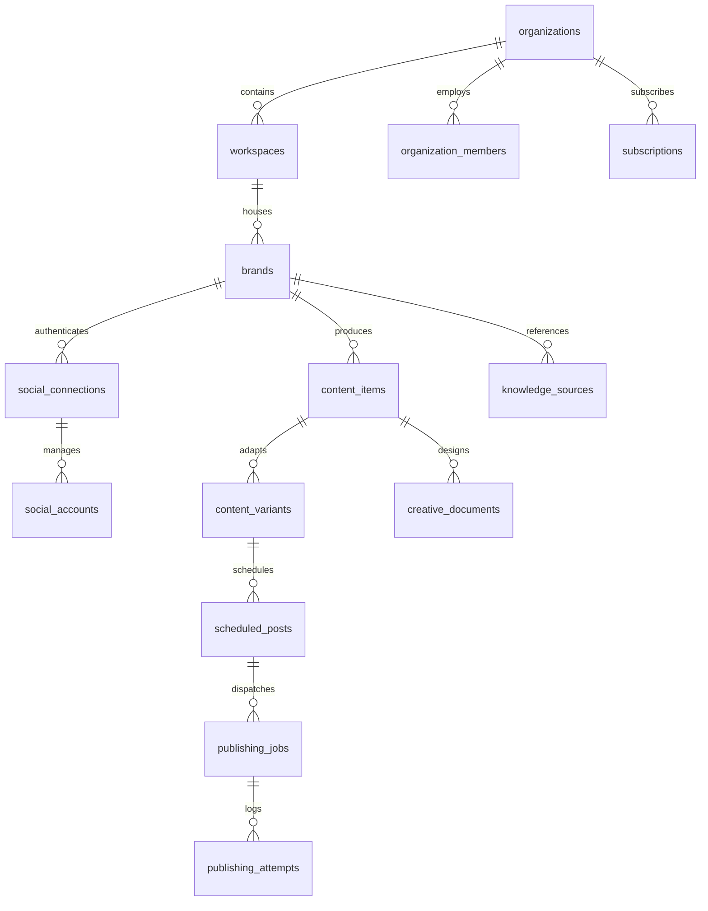

# AutoCanvas — Database Design & Data Dictionary
**Version:** 1.0.0 | **Primary Database:** MySQL 8.0+ | **Date:** 2026-11-10

---

## 1. Core Tenancy & Identity Schema

### Table Specifications

#### 1. `organizations`
Primary multi-tenant root account.
- `id`: `CHAR(26)` Primary Key (ULID)
- `name`: `VARCHAR(255)` NOT NULL
- `slug`: `VARCHAR(255)` UNIQUE NOT NULL
- `timezone`: `VARCHAR(100)` DEFAULT 'UTC'
- `billing_email`: `VARCHAR(255)` NOT NULL
- `status`: `ENUM('active', 'suspended', 'cancelled')` DEFAULT 'active'
- `created_at`, `updated_at`, `deleted_at`

#### 2. `workspaces`
Sub-division within an organization for team and brand isolation.
- `id`: `CHAR(26)` Primary Key (ULID)
- `organization_id`: `CHAR(26)` Foreign Key
- `name`: `VARCHAR(255)` NOT NULL
- `slug`: `VARCHAR(255)` NOT NULL
- `created_at`, `updated_at`, `deleted_at`

#### 3. `brands`
The central operational aggregate root.
- `id`: `CHAR(26)` Primary Key (ULID)
- `organization_id`: `CHAR(26)` Foreign Key (Indexed)
- `workspace_id`: `CHAR(26)` Foreign Key (Indexed)
- `name`: `VARCHAR(255)` NOT NULL
- `industry`: `VARCHAR(100)` NULL
- `website_url`: `VARCHAR(500)` NULL
- `status`: `ENUM('active', 'paused', 'archived')` DEFAULT 'active'
- `automation_policy`: `JSON` NULL (Safety caps, quiet hours, auto-publish gates)
- `created_at`, `updated_at`, `deleted_at`

#### 4. `oauth_tokens`
Encrypted credential vault for third-party social integrations.
- `id`: `CHAR(26)` Primary Key (ULID)
- `organization_id`: `CHAR(26)` Foreign Key (Tenant check)
- `social_account_id`: `CHAR(26)` Foreign Key
- `access_token`: `TEXT` NOT NULL (Encrypted AES-256-GCM)
- `refresh_token`: `TEXT` NULL (Encrypted AES-256-GCM)
- `token_type`: `VARCHAR(50)` DEFAULT 'Bearer'
- `scopes`: `JSON` NOT NULL (Granted permissions)
- `expires_at`: `TIMESTAMP` NULL
- `refreshed_at`: `TIMESTAMP` NULL
- `revoked_at`: `TIMESTAMP` NULL
- `created_at`, `updated_at`

#### 5. `publishing_jobs`
Idempotent dispatch state machine for social publishing.
- `id`: `CHAR(26)` Primary Key (ULID)
- `organization_id`: `CHAR(26)` Foreign Key
- `scheduled_post_id`: `CHAR(26)` Foreign Key
- `social_account_id`: `CHAR(26)` Foreign Key
- `idempotency_key`: `CHAR(64)` UNIQUE NOT NULL (SHA-256)
- `status`: `ENUM('queued', 'locking', 'publishing', 'published', 'failed', 'dead_letter', 'cancelled')`
- `attempt_count`: `TINYINT` DEFAULT 0
- `max_attempts`: `TINYINT` DEFAULT 3
- `external_post_id`: `VARCHAR(255)` NULL (Platform ID once confirmed)
- `provider_response`: `JSON` NULL (Full raw API response)
- `published_at`: `TIMESTAMP` NULL
- `next_retry_at`: `TIMESTAMP` NULL
- `failure_reason`: `TEXT` NULL
- `created_at`, `updated_at`

#### 6. `ai_usage_records`
Strict cost accounting for every LLM and media generation request.
- `id`: `CHAR(26)` Primary Key (ULID)
- `organization_id`: `CHAR(26)` Foreign Key (Indexed)
- `brand_id`: `CHAR(26)` NULL Foreign Key
- `user_id`: `CHAR(26)` NULL Foreign Key
- `provider`: `VARCHAR(50)` NOT NULL ('openai', 'anthropic', 'google')
- `model`: `VARCHAR(100)` NOT NULL
- `task_type`: `VARCHAR(100)` NOT NULL ('content_gen', 'qa_scoring', 'brand_analysis')
- `input_tokens`: `INT` DEFAULT 0
- `output_tokens`: `INT` DEFAULT 0
- `estimated_cost_usd`: `DECIMAL(10, 6)` DEFAULT 0.000000
- `created_at`: `TIMESTAMP` NOT NULL

