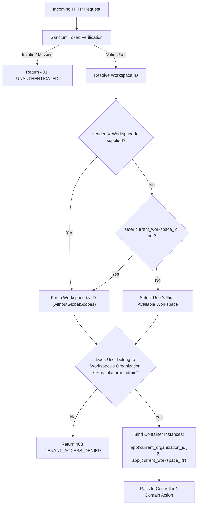

# AutoCanvas — API Architecture & Contracts Specification
**Document ID:** ARCH-API-001  
**Version:** 2.0.0 (Production Master)  
**Base Protocol:** HTTPS / RESTful JSON  
**API Version Prefix:** `/api/v1`  
**Authentication Scheme:** Bearer Token via Laravel Sanctum (Stateful for SPA / Personal Access Tokens for API integrations)  

---

## 1. Unified Response Envelope Standard

Every API response emitted by AutoCanvas strictly conforms to a predictable, standardized JSON envelope. Clients (React frontend, mobile applications, webhooks) must never encounter unformatted raw strings or inconsistent error shapes.

### 1.1 Success Response Envelope
```json
{
  "success": true,
  "data": {
    "id": "01JCAR0A9Z3K1QW8E7M4D2P5XN",
    "name": "Acme Brand",
    "status": "active"
  },
  "meta": {
    "timestamp": "2026-11-10T20:15:00Z",
    "request_id": "req_01JCAR0B2X7M9P"
  },
  "error": null
}
```

### 1.2 Paginated Success Response Envelope
```json
{
  "success": true,
  "data": [
    { "id": "01JCAR0A9Z3K1QW8E7M4D2P5XN", "title": "Summer Campaign Post" }
  ],
  "meta": {
    "pagination": {
      "current_page": 1,
      "per_page": 20,
      "total": 142,
      "last_page": 8,
      "from": 1,
      "to": 20
    },
    "timestamp": "2026-11-10T20:15:00Z"
  },
  "error": null
}
```

### 1.3 Error Response Envelope
```json
{
  "success": false,
  "data": null,
  "meta": {
    "timestamp": "2026-11-10T20:15:00Z",
    "request_id": "req_01JCAR0B2X7M9P"
  },
  "error": {
    "code": "VALIDATION_FAILED",
    "message": "The provided payload failed validation constraints.",
    "details": {
      "name": ["The brand name field is required."],
      "industry": ["The selected industry is invalid."]
    }
  }
}
```

---

## 2. Standardized Error Codes & HTTP Status Mapping

| HTTP Status | Error Code | Description & Trigger Scenario |
|---|---|---|
| **400 Bad Request** | `MALFORMED_REQUEST` | Syntactically invalid JSON or missing mandatory HTTP headers. |
| **401 Unauthorized** | `UNAUTHENTICATED` | Missing, expired, or revoked Sanctum Bearer token. |
| **402 Payment Required**| `ENTITLEMENT_EXCEEDED`| Action blocked because tenant has hit plan usage limits (brands, members, AI tokens). |
| **403 Forbidden** | `PERMISSION_DENIED` | Authenticated user lacks the required RBAC permission or cross-tenant violation. |
| **404 Not Found** | `RESOURCE_NOT_FOUND`| Requested model ID does not exist within the active tenant scope. |
| **409 Conflict** | `IDEMPOTENCY_LOCKED` | Concurrent request received with an active idempotency key lock. |
| **422 Unprocessable** | `VALIDATION_FAILED` | Payload violates Laravel FormRequest validation rules. |
| **429 Too Many Req** | `RATE_LIMIT_EXCEEDED`| Request rate exceeded client throttle window. |
| **500 Internal Error** | `SERVER_ERROR` | Unhandled exception logged with unique `request_id` for administrative debugging. |

---

## 3. Tenant Context Resolution & Security Flow

Every request hitting a tenant-scoped route passes through the `App\Http\Middleware\EnsureTenantScope` middleware:



---

## 4. Control Plane API Specifications (`/api/v1/control-plane/*`)

All Control Plane routes require `auth:sanctum`, verification of `users.is_platform_admin = true`, and authorization via `RequirePermission`.

### 4.1 System & Dashboard Endpoints
- `GET /api/v1/control-plane/metrics`: Real-time system health, tenant count, MRR, active workers, queue backlogs.
- `GET /api/v1/control-plane/system-settings`: Retrieve global settings and feature flags.
- `PUT /api/v1/control-plane/system-settings`: Update runtime settings (records change log with diff).
- `POST /api/v1/control-plane/emergency/circuit-breaker`: Activate/deactivate `PAUSE_ALL_AUTOMATIONS`.

### 4.2 RBAC & Permission Management
- `GET /api/v1/control-plane/rbac/permissions`: List all registered atomic permissions in system.
- `GET /api/v1/control-plane/rbac/roles`: List all system roles and their assigned permissions.
- `POST /api/v1/control-plane/rbac/roles`: Create new custom role with selected permissions.
- `PUT /api/v1/control-plane/rbac/roles/{roleId}`: Update permissions assigned to a role.
- `POST /api/v1/control-plane/rbac/assign`: Assign or revoke a role from an administrative user.

### 4.3 Tenant & Organization Oversight
- `GET /api/v1/control-plane/organizations`: Paginated list of all platform tenants with search, status, and plan filters.
- `GET /api/v1/control-plane/organizations/{orgId}`: Detailed organization audit (members, brands, usage, subscriptions).
- `PUT /api/v1/control-plane/organizations/{orgId}/status`: Suspend, activate, or adjust tenant status.
- `POST /api/v1/control-plane/organizations/{orgId}/impersonate`: Issue a scoped, read-only audit session token.

### 4.4 AI Provider & Model Management
- `GET /api/v1/control-plane/ai/providers`: List registered AI providers (Gemini, Anthropic, OpenAI, Mock).
- `PUT /api/v1/control-plane/ai/routing`: Update task routing rules (e.g., text generation model, vision model).
- `GET /api/v1/control-plane/ai/usage`: Aggregated token consumption, latency, and cost telemetry.

### 4.5 Billing & Offline Payment Verification Queue
- `GET /api/v1/control-plane/billing/verification-queue`: List pending bKash, Nagad, and bank wire transactions.
- `POST /api/v1/control-plane/billing/transactions/{trxId}/verify`: Approve payment, mark invoice paid, activate subscription.
- `POST /api/v1/control-plane/billing/transactions/{trxId}/reject`: Reject payment with reason.

### 4.6 Natural-Language Command Interface
- `POST /api/v1/control-plane/command`:
  - **Payload:** `{ "query": "Pause publishing for organization acme-inc" }`
  - **Response:** Intent classification, extracted parameters, safety tier (`safe` | `destructive`), and confirmation token if destructive.
- `POST /api/v1/control-plane/command/confirm`:
  - **Payload:** `{ "confirmation_token": "cf_01JCAR9...", "proceed": true }`
  - **Response:** Execution output and audit log record.

---

## 5. Tenant Plane API Endpoints (`/api/v1/*`)

### 5.1 Authentication & Profile
- `POST /api/v1/auth/register`: Public registration, creates user, organization, workspace, assigns starter plan.
- `POST /api/v1/auth/login`: Issue Sanctum token.
- `POST /api/v1/auth/logout`: Revoke token.
- `GET /api/v1/auth/me`: Get active user profile, permissions, active organization, and workspace.
- `POST /api/v1/auth/switch-workspace`: Switch active workspace context.

### 5.2 Organizations & Workspaces
- `GET /api/v1/organizations`: List user's organizations.
- `PUT /api/v1/organizations/{id}`: Update organization profile.
- `GET /api/v1/workspaces`: List workspaces in active organization.
- `POST /api/v1/workspaces`: Create workspace (verified against plan entitlement limit).
- `GET /api/v1/organization/members`: List team members and roles.
- `POST /api/v1/organization/members/invite`: Invite member with role (`owner`, `admin`, `editor`, `viewer`).

### 5.3 Billing & Local Payments
- `GET /api/v1/billing/plans`: List active pricing tiers.
- `GET /api/v1/billing/subscription`: Active plan status, renewal dates, and real-time entitlement usage.
- `POST /api/v1/billing/checkout`: Generate invoice for upgrade/renewal.
- `POST /api/v1/billing/payments/submit-trx`: Submit bKash or Nagad transaction ID for verification.

### 5.4 Brand Intelligence & Knowledge Base
- `GET /api/v1/brands`: List brands in active workspace.
- `POST /api/v1/brands`: Create brand (verified against plan entitlement limit).
- `GET /api/v1/brands/{id}`: Full brand profile, visual tokens, voice parameters, and memory summary.
- `PUT /api/v1/brands/{id}/profile`: Update brand bio, target audience, and positioning.
- `PUT /api/v1/brands/{id}/voice`: Update tone descriptors, sample copy, and vocabulary rules.
- `PUT /api/v1/brands/{id}/visual-identity`: Update hex palettes, typography, and logo assets.
- `POST /api/v1/brands/{id}/knowledge`: Upload document or URL for chunking and ingestion.
- `GET /api/v1/brands/{id}/knowledge`: List ingested knowledge sources and chunk status.
- `POST /api/v1/brands/{id}/discovery`: Run automated AI brand audit from website URL.

### 5.5 Research & Opportunity Radar
- `GET /api/v1/brands/{id}/feeds`: List subscribed RSS feeds.
- `POST /api/v1/brands/{id}/feeds`: Add RSS feed.
- `POST /api/v1/research/feeds/{feedId}/sync`: Trigger manual feed pull.
- `GET /api/v1/brands/{id}/articles`: Paginated feed articles with keyword filters.
- `POST /api/v1/research/articles/{articleId}/toggle-save`: Bookmark article for content planning.
- `GET /api/v1/brands/{id}/competitors`: List tracked competitor accounts.
- `POST /api/v1/brands/{id}/competitors`: Add competitor for social monitoring.
- `GET /api/v1/brands/{id}/opportunities`: Real-time detected content opportunities.
- `POST /api/v1/research/opportunities/{oppId}/convert`: Convert opportunity into draft content item.

### 5.6 Content Strategy, Production & Creative Studio
- `GET /api/v1/brands/{id}/pillars`: Content pillars and target percentage allocations.
- `POST /api/v1/brands/{id}/pillars`: Create content pillar.
- `GET /api/v1/brands/{id}/campaigns`: Marketing campaigns.
- `POST /api/v1/brands/{id}/content`: Create content draft.
- `POST /api/v1/brands/{id}/content/generate`: AI-assisted draft generation using brand voice and knowledge RAG.
- `POST /api/v1/brands/{id}/content/{contentId}/qa-evaluate`: Run AI quality, compliance, and brand safety check.
- `POST /api/v1/brands/{id}/content/{contentId}/submit-review`: Transition to pending approval.
- `POST /api/v1/brands/{id}/content/{contentId}/approve`: Approve for scheduling/publishing.
- `GET /api/v1/creative/templates`: Available HTML/SVG creative layout templates.
- `POST /api/v1/creative/render`: Trigger deterministic Chromium render for visual asset.

### 5.7 Social Connectors & Publishing Engine
- `GET /api/v1/social/connectors`: Connection status of Facebook, Instagram, LinkedIn accounts.
- `GET /api/v1/social/connectors/{platform}/oauth-url`: Generate official OAuth2 authorization URL with CSRF state.
- `POST /api/v1/social/connectors/{platform}/callback`: Exchange auth code for tokens and save encrypted credentials.
- `DELETE /api/v1/social/connectors/{accountId}`: Disconnect account and revoke tokens.
- `GET /api/v1/publishing/calendar`: Scheduled posts formatted for FullCalendar (`start`, `end`, `title`, `status`).
- `POST /api/v1/publishing/schedule`: Schedule post variant with destination and UTC timestamp.
- `POST /api/v1/publishing/publish-now`: Immediate idempotent dispatch.

### 5.8 Community Management & Unified Inbox
- `GET /api/v1/community/threads`: Incoming comments and direct messages across all connected channels.
- `POST /api/v1/community/threads/{threadId}/reply`: Post reply to platform API.
- `POST /api/v1/community/threads/{threadId}/suggest-reply`: AI generates on-brand reply suggestions.

### 5.9 Analytics & Telemetry
- `GET /api/v1/analytics/overview`: High-level reach, engagement, follower growth, and post frequency.
- `GET /api/v1/analytics/posts`: Post-by-post performance telemetry.

### 5.10 Complete CMS Engine
- `GET /api/v1/cms/pages`: List public marketing pages.
- `GET /api/v1/cms/pages/{slug}`: Public page content (for SSR/SSG or frontend client).
- `GET /api/v1/cms/in-app/announcements`: Active in-app banner announcements and onboarding guides.

---

## 6. Throttling & Rate Limiting Policies

Configured via Laravel rate limiters in `RouteServiceProvider` / `AppServiceProvider`:

- `throttle:public`: 60 requests / minute per client IP.
- `throttle:auth`: 10 requests / minute per client IP (prevents brute-force on `/auth/login` and `/auth/register`).
- `throttle:tenant`: 120 requests / minute per authenticated user.
- `throttle:ai-generation`: 20 requests / minute per organization.
- `throttle:control-plane`: 60 requests / minute per administrative user.

---
*Signed by Principal Software Architect & API Lead*  
*AutoCanvas Platform Engineering Team*

