# AutoCanvas — Database Architecture & Data Modeling Specification
**Document ID:** ARCH-DB-001  
**Version:** 2.0.0 (Production Master)  
**Database Engine:** MySQL 8.0+ / MariaDB 10.11+ (Strict Mode: `STRICT_TRANS_TABLES,NO_ENGINE_SUBSTITUTION`)  
**Collation:** `utf8mb4_unicode_ci`  

---

## 1. Data Architecture Principles

1. **Deterministic Primary Keys:** All application and domain tables utilize Universally Unique Lexicographically Sortable Identifiers (ULID) stored as `CHAR(26)`. This guarantees chronological sortability, eliminates sequential integer ID enumeration vulnerabilities, and simplifies cross-database replication.
2. **Strict Multi-Tenancy Scoping:** Every tenant-bound table contains an indexed `organization_id CHAR(26)` column with a strict foreign key reference to `organizations(id) ON DELETE CASCADE`.
3. **Compound Tenant Indexing:** Single-column indexes on tenant tables are prohibited for query filtering. Every index must be compounded with `organization_id` as the leading column (e.g., `INDEX (organization_id, status, created_at)`), ensuring optimal index scan isolation in MySQL's B-Tree engine.
4. **Plane Separation in Storage:** Control Plane administrative tables (e.g., `system_settings`, `admin_users`, `permissions`, `roles`, `global_social_apps`, `payment_transactions`) exist in the same database instance but carry NO `organization_id` column, signaling to the query layer that they are exempt from `HasTenantScope`.
5. **High-Volume Data Archival:** Append-only telemetry and log tables (`audit_logs`, `ai_usage_records`, `publishing_attempts`, `analytics_metrics`, `rss_articles`) are designed with date-partitioned retention policies and automatic pruning schedules.

---

## 2. Comprehensive Entity-Relationship Diagram (ERD)

```mermaid
erDiagram
    %% Core & Control Plane Entities
    USERS ||--o{ ORGANIZATION_MEMBERS : "belongs to"
    USERS ||--o{ WORKSPACE_MEMBERS : "assigned to"
    USERS ||--o{ USER_ROLES : "assigned"
    ROLES ||--o{ USER_ROLES : "grants"
    ROLES ||--o{ ROLE_PERMISSIONS : "contains"
    PERMISSIONS ||--o{ ROLE_PERMISSIONS : "defined by"

    SYSTEM_SETTINGS {
        string key PK
        json value
        string category
        boolean is_secret
    }

    SYSTEM_CHANGE_LOGS {
        char id PK
        char user_id FK
        string entity_type
        char entity_id
        json old_values
        json new_values
        datetime created_at
    }

    %% Tenant Foundation Entities
    ORGANIZATIONS ||--o{ WORKSPACES : "owns"
    ORGANIZATIONS ||--o{ ORGANIZATION_MEMBERS : "members"
    ORGANIZATIONS ||--o{ SUBSCRIPTIONS : "billed via"
    ORGANIZATIONS ||--o{ BRANDS : "operates"
    ORGANIZATIONS ||--o{ SOCIAL_ACCOUNTS : "connects"
    ORGANIZATIONS ||--o{ AUDIT_LOGS : "logs"
    ORGANIZATIONS ||--o{ INVOICES : "receives"

    PLANS ||--o{ SUBSCRIPTIONS : "defines tier"
    SUBSCRIPTIONS ||--o{ INVOICES : "generates"
    INVOICES ||--o{ PAYMENT_TRANSACTIONS : "settled by"

    %% Brand & Intelligence Entities
    BRANDS ||--o{ BRAND_PROFILES : "has"
    BRANDS ||--o{ BRAND_VISUAL_IDENTITIES : "has"
    BRANDS ||--o{ BRAND_VOICE_PROFILES : "has"
    BRANDS ||--o{ BRAND_ASSETS : "stores"
    BRANDS ||--o{ BRAND_MEMORY_ENTRIES : "retains"
    BRANDS ||--o{ KNOWLEDGE_SOURCES : "ingests"
    BRANDS ||--o{ CONTENT_PILLARS : "targets"
    BRANDS ||--o{ CAMPAIGNS : "executes"
    BRANDS ||--o{ COMPETITORS : "monitors"
    BRANDS ||--o{ RSS_FEEDS : "subscribes"
    BRANDS ||--o{ TREND_OPPORTUNITIES : "detects"

    KNOWLEDGE_SOURCES ||--o{ KNOWLEDGE_CHUNKS : "chunks into"
    RSS_FEEDS ||--o{ RSS_ARTICLES : "fetches"

    %% Content Production & Publishing Entities
    CONTENT_PILLARS ||--o{ CONTENT_ITEMS : "guides"
    CAMPAIGNS ||--o{ CONTENT_ITEMS : "groups"
    CONTENT_ITEMS ||--o{ CONTENT_VARIANTS : "has platform copies"
    CONTENT_VARIANTS ||--o{ CREATIVE_DOCUMENTS : "has visual design"
    CONTENT_VARIANTS ||--o{ PUBLISHING_JOBS : "schedules"

    PUBLISHING_JOBS ||--o{ PUBLISHING_ATTEMPTS : "tracks execution"
    SOCIAL_ACCOUNTS ||--o{ PUBLISHING_JOBS : "publishes to"

    %% Community & Analytics Entities
    SOCIAL_ACCOUNTS ||--o{ COMMUNITY_COMMENTS : "receives"
    COMMUNITY_COMMENTS ||--o{ AI_REPLY_SUGGESTIONS : "generates"
    SOCIAL_ACCOUNTS ||--o{ ANALYTICS_METRICS : "measures"
    ORGANIZATIONS ||--o{ AI_USAGE_RECORDS : "billed tokens"
```



---

## 3. Schema Definitions & Table Specifications

### 3.1 Control Plane & Security Tables

#### `permissions`
Defines atomic system capabilities across both Control Plane and Tenant operations.
```sql
CREATE TABLE permissions (
    id CHAR(26) NOT NULL PRIMARY KEY,
    name VARCHAR(100) NOT NULL UNIQUE,       -- e.g., 'system.organizations.view'
    display_name VARCHAR(150) NOT NULL,
    category VARCHAR(50) NOT NULL,          -- e.g., 'system', 'billing', 'publishing'
    description TEXT NULL,
    created_at TIMESTAMP NULL,
    updated_at TIMESTAMP NULL
) ENGINE=InnoDB DEFAULT CHARSET=utf8mb4 COLLATE=utf8mb4_unicode_ci;
```

#### `roles`
Named permission bundles assignable to platform admins or tenant members.
```sql
CREATE TABLE roles (
    id CHAR(26) NOT NULL PRIMARY KEY,
    name VARCHAR(100) NOT NULL UNIQUE,       -- e.g., 'superadmin', 'support_agent', 'org_owner'
    display_name VARCHAR(150) NOT NULL,
    scope ENUM('system', 'organization', 'workspace') NOT NULL DEFAULT 'organization',
    is_system_preset BOOLEAN NOT NULL DEFAULT FALSE,
    created_at TIMESTAMP NULL,
    updated_at TIMESTAMP NULL
) ENGINE=InnoDB DEFAULT CHARSET=utf8mb4 COLLATE=utf8mb4_unicode_ci;
```

#### `role_permissions`
Pivot linking roles to their granular permissions.
```sql
CREATE TABLE role_permissions (
    role_id CHAR(26) NOT NULL,
    permission_id CHAR(26) NOT NULL,
    PRIMARY KEY (role_id, permission_id),
    CONSTRAINT fk_rp_role FOREIGN KEY (role_id) REFERENCES roles(id) ON DELETE CASCADE,
    CONSTRAINT fk_rp_permission FOREIGN KEY (permission_id) REFERENCES permissions(id) ON DELETE CASCADE
) ENGINE=InnoDB DEFAULT CHARSET=utf8mb4 COLLATE=utf8mb4_unicode_ci;
```

#### `user_roles`
Direct assignment of roles to users across system or organization context.
```sql
CREATE TABLE user_roles (
    user_id CHAR(26) NOT NULL,
    role_id CHAR(26) NOT NULL,
    organization_id CHAR(26) NULL,           -- NULL if system-wide role
    PRIMARY KEY (user_id, role_id, organization_id),
    CONSTRAINT fk_ur_user FOREIGN KEY (user_id) REFERENCES users(id) ON DELETE CASCADE,
    CONSTRAINT fk_ur_role FOREIGN KEY (role_id) REFERENCES roles(id) ON DELETE CASCADE,
    CONSTRAINT fk_ur_org FOREIGN KEY (organization_id) REFERENCES organizations(id) ON DELETE CASCADE
) ENGINE=InnoDB DEFAULT CHARSET=utf8mb4 COLLATE=utf8mb4_unicode_ci;
```

#### `system_settings`
Global runtime configurations managed through the Master Control Panel.
```sql
CREATE TABLE system_settings (
    `key` VARCHAR(100) NOT NULL PRIMARY KEY,
    `value` JSON NOT NULL,
    category VARCHAR(50) NOT NULL DEFAULT 'general',
    is_secret BOOLEAN NOT NULL DEFAULT FALSE,
    updated_by CHAR(26) NULL,
    created_at TIMESTAMP NULL,
    updated_at TIMESTAMP NULL,
    CONSTRAINT fk_ss_updated_by FOREIGN KEY (updated_by) REFERENCES users(id) ON DELETE SET NULL
) ENGINE=InnoDB DEFAULT CHARSET=utf8mb4 COLLATE=utf8mb4_unicode_ci;
```

---

### 3.2 Tenant Core & Billing Tables

#### `organizations`
Root legal entity, multi-tenant billing subject, and top-level boundary.
```sql
CREATE TABLE organizations (
    id CHAR(26) NOT NULL PRIMARY KEY,
    name VARCHAR(255) NOT NULL,
    slug VARCHAR(100) NOT NULL UNIQUE,
    billing_email VARCHAR(255) NOT NULL,
    timezone VARCHAR(50) NOT NULL DEFAULT 'UTC',
    status ENUM('active', 'suspended', 'delinquent', 'pending_setup') NOT NULL DEFAULT 'active',
    settings JSON NULL,
    created_at TIMESTAMP NULL,
    updated_at TIMESTAMP NULL,
    INDEX idx_org_status (status),
    INDEX idx_org_slug (slug)
) ENGINE=InnoDB DEFAULT CHARSET=utf8mb4 COLLATE=utf8mb4_unicode_ci;
```

#### `invoices` & `payment_transactions`
Handles both automated and manual offline payment flows (bKash, Nagad, Bank Wire).
```sql
CREATE TABLE invoices (
    id CHAR(26) NOT NULL PRIMARY KEY,
    organization_id CHAR(26) NOT NULL,
    invoice_number VARCHAR(50) NOT NULL UNIQUE,
    plan_id CHAR(26) NOT NULL,
    amount DECIMAL(10, 2) NOT NULL,
    currency VARCHAR(3) NOT NULL DEFAULT 'BDT', -- Supports BDT / USD
    billing_period_start DATE NOT NULL,
    billing_period_end DATE NOT NULL,
    due_date DATE NOT NULL,
    status ENUM('unpaid', 'processing', 'paid', 'void', 'failed') NOT NULL DEFAULT 'unpaid',
    metadata JSON NULL,
    created_at TIMESTAMP NULL,
    updated_at TIMESTAMP NULL,
    CONSTRAINT fk_inv_org FOREIGN KEY (organization_id) REFERENCES organizations(id) ON DELETE CASCADE,
    CONSTRAINT fk_inv_plan FOREIGN KEY (plan_id) REFERENCES plans(id),
    INDEX idx_inv_org_status (organization_id, status)
) ENGINE=InnoDB DEFAULT CHARSET=utf8mb4 COLLATE=utf8mb4_unicode_ci;

CREATE TABLE payment_transactions (
    id CHAR(26) NOT NULL PRIMARY KEY,
    invoice_id CHAR(26) NOT NULL,
    organization_id CHAR(26) NOT NULL,
    gateway ENUM('bkash', 'nagad', 'bank_wire', 'manual') NOT NULL,
    transaction_reference VARCHAR(150) NOT NULL, -- TrxID submitted by user or gateway
    gateway_payment_id VARCHAR(150) NULL,        -- Payment ID from provider API
    amount DECIMAL(10, 2) NOT NULL,
    currency VARCHAR(3) NOT NULL DEFAULT 'BDT',
    idempotency_key VARCHAR(64) NOT NULL UNIQUE,
    status ENUM('pending', 'verified', 'rejected') NOT NULL DEFAULT 'pending',
    verified_by CHAR(26) NULL,                  -- Admin User ID if manual verification
    verified_at TIMESTAMP NULL,
    gateway_response JSON NULL,
    created_at TIMESTAMP NULL,
    updated_at TIMESTAMP NULL,
    CONSTRAINT fk_pt_invoice FOREIGN KEY (invoice_id) REFERENCES invoices(id) ON DELETE CASCADE,
    CONSTRAINT fk_pt_org FOREIGN KEY (organization_id) REFERENCES organizations(id) ON DELETE CASCADE,
    CONSTRAINT fk_pt_verifier FOREIGN KEY (verified_by) REFERENCES users(id) ON DELETE SET NULL,
    INDEX idx_pt_org (organization_id),
    INDEX idx_pt_status (status),
    INDEX idx_pt_ref (gateway, transaction_reference)
) ENGINE=InnoDB DEFAULT CHARSET=utf8mb4 COLLATE=utf8mb4_unicode_ci;
```

---

### 3.3 Social Connectors & Cryptographic Token Storage

#### `social_accounts`
Stores authenticated social channel connections with envelope-encrypted OAuth credentials.
```sql
CREATE TABLE social_accounts (
    id CHAR(26) NOT NULL PRIMARY KEY,
    organization_id CHAR(26) NOT NULL,
    workspace_id CHAR(26) NOT NULL,
    brand_id CHAR(26) NOT NULL,
    platform ENUM('facebook', 'instagram', 'linkedin', 'youtube', 'tiktok', 'x', 'pinterest') NOT NULL,
    account_type ENUM('page', 'profile', 'business') NOT NULL DEFAULT 'page',
    platform_account_id VARCHAR(150) NOT NULL,
    account_name VARCHAR(255) NOT NULL,
    avatar_url TEXT NULL,
    access_token TEXT NOT NULL,                  -- Encrypted via AES-256-GCM
    refresh_token TEXT NULL,                  -- Encrypted via AES-256-GCM
    token_expires_at TIMESTAMP NULL,
    scopes JSON NOT NULL,
    is_active BOOLEAN NOT NULL DEFAULT TRUE,
    connection_status ENUM('connected', 'expired', 'revoked', 'rate_limited') NOT NULL DEFAULT 'connected',
    metadata JSON NULL,
    last_synced_at TIMESTAMP NULL,
    created_at TIMESTAMP NULL,
    updated_at TIMESTAMP NULL,
    CONSTRAINT fk_sa_org FOREIGN KEY (organization_id) REFERENCES organizations(id) ON DELETE CASCADE,
    CONSTRAINT fk_sa_ws FOREIGN KEY (workspace_id) REFERENCES workspaces(id) ON DELETE CASCADE,
    CONSTRAINT fk_sa_brand FOREIGN KEY (brand_id) REFERENCES brands(id) ON DELETE CASCADE,
    UNIQUE KEY uq_platform_account (organization_id, platform, platform_account_id),
    INDEX idx_sa_brand (brand_id),
    INDEX idx_sa_status (platform, connection_status)
) ENGINE=InnoDB DEFAULT CHARSET=utf8mb4 COLLATE=utf8mb4_unicode_ci;
```

---

### 3.4 Content Production, Creative Studio & Publishing

#### `creative_documents`
Stores vector layout directives, canvas layers, and styling specifications for deterministic rendering.
```sql
CREATE TABLE creative_documents (
    id CHAR(26) NOT NULL PRIMARY KEY,
    organization_id CHAR(26) NOT NULL,
    brand_id CHAR(26) NOT NULL,
    name VARCHAR(255) NOT NULL,
    aspect_ratio ENUM('1:1', '4:5', '9:16', '16:9') NOT NULL DEFAULT '1:1',
    width INT NOT NULL DEFAULT 1080,
    height INT NOT NULL DEFAULT 1080,
    layers JSON NOT NULL,                      -- Layer tree: text, rects, shapes, logos, images
    background_config JSON NOT NULL,           -- Color token, gradient, or background image
    rendered_preview_url TEXT NULL,
    rendered_highres_url TEXT NULL,
    render_status ENUM('draft', 'rendering', 'ready', 'failed') NOT NULL DEFAULT 'draft',
    render_error TEXT NULL,
    created_at TIMESTAMP NULL,
    updated_at TIMESTAMP NULL,
    CONSTRAINT fk_cd_org FOREIGN KEY (organization_id) REFERENCES organizations(id) ON DELETE CASCADE,
    CONSTRAINT fk_cd_brand FOREIGN KEY (brand_id) REFERENCES brands(id) ON DELETE CASCADE,
    INDEX idx_cd_brand (brand_id, render_status)
) ENGINE=InnoDB DEFAULT CHARSET=utf8mb4 COLLATE=utf8mb4_unicode_ci;
```

#### `publishing_jobs` & `publishing_attempts`
Guarantees idempotent social dispatch, multi-destination fanout, and automated retry backoff.
```sql
CREATE TABLE publishing_jobs (
    id CHAR(26) NOT NULL PRIMARY KEY,
    organization_id CHAR(26) NOT NULL,
    workspace_id CHAR(26) NOT NULL,
    content_variant_id CHAR(26) NOT NULL,
    social_account_id CHAR(26) NOT NULL,
    scheduled_at TIMESTAMP NOT NULL,
    published_at TIMESTAMP NULL,
    status ENUM('scheduled', 'queued', 'processing', 'completed', 'failed', 'cancelled') NOT NULL DEFAULT 'scheduled',
    idempotency_key VARCHAR(64) NOT NULL UNIQUE,
    remote_post_id VARCHAR(150) NULL,
    remote_post_url TEXT NULL,
    error_message TEXT NULL,
    attempt_count INT NOT NULL DEFAULT 0,
    max_attempts INT NOT NULL DEFAULT 3,
    created_at TIMESTAMP NULL,
    updated_at TIMESTAMP NULL,
    CONSTRAINT fk_pj_org FOREIGN KEY (organization_id) REFERENCES organizations(id) ON DELETE CASCADE,
    CONSTRAINT fk_pj_variant FOREIGN KEY (content_variant_id) REFERENCES content_variants(id) ON DELETE CASCADE,
    CONSTRAINT fk_pj_social FOREIGN KEY (social_account_id) REFERENCES social_accounts(id) ON DELETE CASCADE,
    INDEX idx_pj_schedule (status, scheduled_at),
    INDEX idx_pj_org_schedule (organization_id, scheduled_at)
) ENGINE=InnoDB DEFAULT CHARSET=utf8mb4 COLLATE=utf8mb4_unicode_ci;

CREATE TABLE publishing_attempts (
    id CHAR(26) NOT NULL PRIMARY KEY,
    organization_id CHAR(26) NOT NULL,
    publishing_job_id CHAR(26) NOT NULL,
    attempt_number INT NOT NULL,
    status ENUM('success', 'failed') NOT NULL,
    http_status_code INT NULL,
    error TEXT NULL,
    response_payload JSON NULL,
    created_at TIMESTAMP NULL,
    CONSTRAINT fk_pa_org FOREIGN KEY (organization_id) REFERENCES organizations(id) ON DELETE CASCADE,
    CONSTRAINT fk_pa_job FOREIGN KEY (publishing_job_id) REFERENCES publishing_jobs(id) ON DELETE CASCADE,
    INDEX idx_pa_job (publishing_job_id)
) ENGINE=InnoDB DEFAULT CHARSET=utf8mb4 COLLATE=utf8mb4_unicode_ci;
```

---

## 4. Indexing & Query Optimization Strategy

1. **Covering Indexes for API Hot Paths:**
   - Active brand listings: `(organization_id, is_active, name)`
   - Scheduled calendar posts: `(organization_id, status, scheduled_at)`
   - Inbox comment threads: `(organization_id, is_resolved, created_at)`
   - RSS article feeds: `(rss_feed_id, published_at DESC)`
2. **Deterministic Locking Support:**
   - To support cPanel database locking without deadlocks, operations requiring row locks select using `WHERE id = ? FOR UPDATE` on ULID primary keys, guaranteeing index-level row locking rather than table-level locks.
3. **Full-Text Search Indexing:**
   - Knowledge chunks: `FULLTEXT(content)`
   - RSS articles: `FULLTEXT(title, summary)`
   - Brand memory: `FULLTEXT(content)`

---

## 5. High-Volume Archival & Pruning Policy

To maintain high performance on shared storage, append-heavy tables are pruned via the scheduled console command `php artisan platform:prune-telemetry`:

| Table | Retention Period | Pruning Mechanism |
|---|---|---|
| `audit_logs` | 365 Days | Retained for compliance; exported to cold JSON archive after 1 year. |
| `publishing_attempts` | 90 Days | Hard deleted where parent `publishing_jobs.status = 'completed'`. |
| `rss_articles` | 30 Days | Unsaved articles (`is_saved = FALSE`) older than 30 days are purged. |
| `ai_usage_records` | 180 Days | Daily aggregates stored in `ai_daily_aggregates`; raw logs purged. |
| `analytics_metrics` | 365 Days | Raw hourly snapshots consolidated to daily metrics after 60 days. |

---
*Signed by Principal Software Architect & Lead Database Engineer*  
*AutoCanvas Platform Engineering Team*

