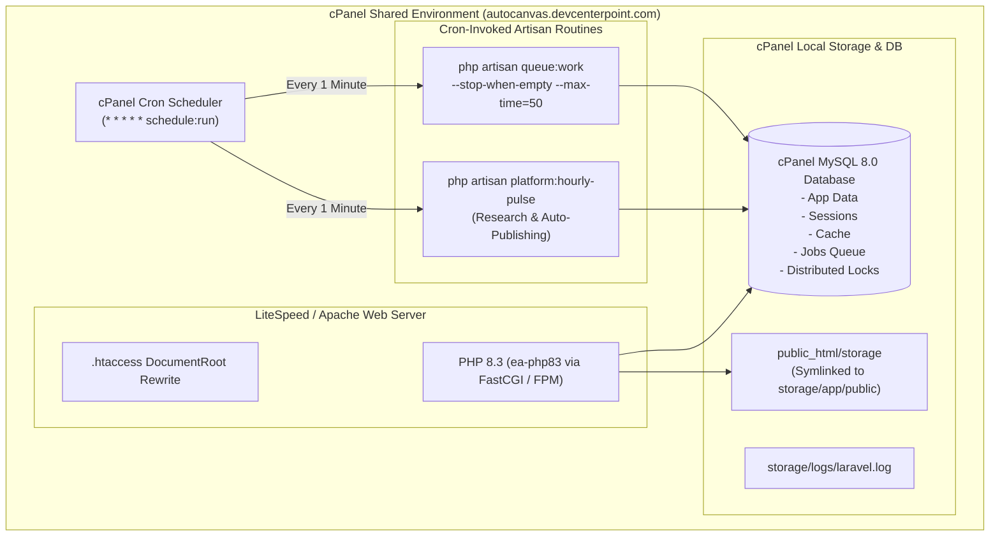
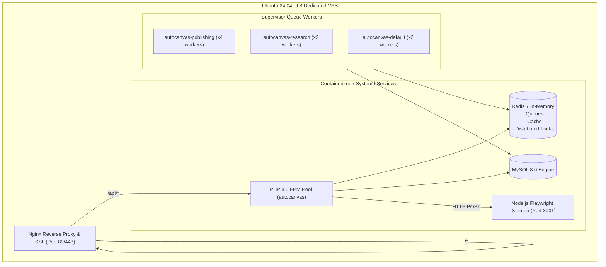

# AutoCanvas — Deployment & Infrastructure Architecture Specification
**Document ID:** ARCH-DEP-001  
**Version:** 2.0.0 (Production Master)  
**Primary Domain:** `autocanvas.devcenterpoint.com`  
**Deployment Phases:** Phase 1 (cPanel Shared / Reseller Hosting) -> Phase 2 (Dedicated VPS / Docker Compose)  

---

## 1. Deployment Philosophy & Dual-Hosting Strategy

AutoCanvas is specifically engineered to reconcile two traditionally conflicting SaaS objectives:
1. **Low Operational Overhead & Cost for Solo Founder:** Enables frictionless, inexpensive launch on standard shared cPanel hosting accounts without requiring root privileges, persistent system daemons, or expensive cloud infrastructure.
2. **Zero-Code VPS Portability:** Built with modular drivers and database fallbacks so that migrating to a dedicated Linux VPS (Ubuntu 24.04 LTS with Docker, Redis, Nginx, and Supervisor) requires only environment configuration updates, with zero changes to application code.

---

## 2. Target 1: Initial cPanel Hosting Architecture



### 2.1 File System & Document Root Configuration
On cPanel, public web traffic enters `public_html/` or a subdomain folder `public_html/autocanvas/`. The Laravel repository is structured to place the sensitive framework code outside the public web root:

```text
/home/username/
├── autocanvas_core/            # Full Laravel Application (backend)
│   ├── app/
│   ├── config/
│   ├── database/
│   ├── storage/
│   └── artisan
│
└── public_html/                # Web Accessible Root (autocanvas.devcenterpoint.com)
    ├── index.php               # Bootstrapper requiring ../autocanvas_core/vendor/autoload.php
    ├── .htaccess               # ModRewrite security & compression rules
    ├── assets/                 # Built React 19 Frontend SPA (from frontend/dist)
    └── storage/                # Symlinked to /home/username/autocanvas_core/storage/app/public
```

### 2.2 `.htaccess` Hardening & SPA Routing
```apache
<IfModule mod_rewrite.c>
    RewriteEngine On

    # Force HTTPS
    RewriteCond %{HTTPS} off
    RewriteRule ^(.*)$ https://%{HTTP_HOST}%{REQUEST_URI} [L,R=301]

    # Handle Authorization Header for Sanctum Bearer Tokens
    RewriteCond %{HTTP:Authorization} .
    RewriteRule .* - [E=HTTP_AUTHORIZATION:%{HTTP:Authorization}]

    # Route API Requests to Laravel Backend index.php
    RewriteCond %{REQUEST_URI} ^/api/
    RewriteRule ^ index.php [L]

    # Direct existing static assets (JS, CSS, Images, Storage)
    RewriteCond %{REQUEST_FILENAME} -d [OR]
    RewriteCond %{REQUEST_FILENAME} -f
    RewriteRule ^ - [L]

    # Route all other frontend routes to SPA index.html
    RewriteRule ^ index.html [L]
</IfModule>

# Prevent directory browsing and block hidden files
Options -Indexes
<FilesMatch "^\.">
    Order allow,deny
    Deny from all
</FilesMatch>
```

### 2.3 cPanel Cron Configuration
In cPanel's **Cron Jobs** interface, configure two scheduled commands:

1. **Master Laravel Scheduler (Every Minute):**
   ```bash
   * * * * * /usr/local/bin/ea-php83 /home/username/autocanvas_core/artisan schedule:run >> /dev/null 2>&1
   ```
2. **Transient Queue Worker (Every Minute, Self-Terminating):**
   ```bash
   * * * * * /usr/local/bin/ea-php83 /home/username/autocanvas_core/artisan queue:work --stop-when-empty --max-time=50 --max-jobs=50 >> /dev/null 2>&1
   ```
   *Explanation:* This pattern prevents runaway zombie processes on shared servers. The worker processes queued jobs until empty or until 50 seconds have elapsed, exiting before the next minute's cron fires.

### 2.4 Database & Cache Drivers on cPanel
In `.env` for cPanel:
```ini
CACHE_STORE=database
SESSION_DRIVER=database
QUEUE_CONNECTION=database
LOCK_DRIVER=database
```
- Distributed locks utilize MySQL's native `GET_LOCK('publish_job_xxx', 60)` function via Laravel's `Cache::lock()`, providing atomic concurrency guarantees without requiring Redis.

---

## 3. Target 2: Dedicated VPS Migration Blueprint

When tenant load grows (typically >50 active organizations or high-frequency publishing queues), the system transitions to a dedicated Virtual Private Server (VPS).



### 3.1 VPS Environment Stack
- **OS:** Ubuntu 24.04 LTS (Noble Numbat)
- **Web Server:** Nginx 1.26+ with HTTP/2 and Brotli compression
- **PHP:** PHP 8.3-FPM (`ondrej/php` PPA) with `opcache`, `pcntl`, `redis`, `gd`, `intl`
- **Database:** MySQL 8.0 Server or Managed Database (DigitalOcean, Hetzner, AWS RDS)
- **In-Memory Store:** Redis 7.2 Server (`redis-server`)
- **Process Manager:** `supervisor` managing long-running Laravel queue workers
- **Node.js Renderer:** Node.js 20 LTS managed via PM2 or Systemd service

### 3.2 Supervisor Configuration for VPS
File: `/etc/supervisor/conf.d/autocanvas-worker.conf`
```ini
[program:autocanvas-worker]
process_name=%(program_name)s_%(process_num)02d
command=php /var/www/autocanvas/artisan queue:work redis --sleep=3 --tries=3 --max-time=3600
autostart=true
autorestart=true
stopasgroup=true
killasgroup=true
user=www-data
numprocs=4
redirect_stderr=true
stdout_logfile=/var/log/supervisor/autocanvas-worker.log
stopwaitsecs=3600
```

### 3.3 Zero-Downtime Migration Playbook
1. **Pre-Migration:**
   - Provision VPS, install Nginx, PHP 8.3, MySQL, Redis, and Playwright Chromium dependencies.
   - Deploy code repository to `/var/www/autocanvas`.
2. **Data Export & Import:**
   - Put cPanel application into maintenance mode: `php artisan down`.
   - Export cPanel MySQL database: `mysqldump -u user -p db_name > migration.sql`.
   - Import into VPS MySQL: `mysql -u root -p autocanvas < migration.sql`.
   - Sync storage directory: `rsync -avz /home/username/autocanvas_core/storage/app/ /var/www/autocanvas/storage/app/`.
3. **Environment Switch:**
   - Update `.env` on VPS to enable `QUEUE_CONNECTION=redis`, `CACHE_STORE=redis`, `SESSION_DRIVER=redis`.
   - Run database migrations to ensure schema currency: `php artisan migrate --force`.
4. **DNS Cutover:**
   - Update `A` record for `autocanvas.devcenterpoint.com` to VPS public IP.
   - Run Certbot for SSL: `certbot --nginx -d autocanvas.devcenterpoint.com`.
   - Bring application live: `php artisan up`.

---
*Signed by Principal Infrastructure Architect & DevOps Lead*  
*AutoCanvas Platform Engineering Team*

