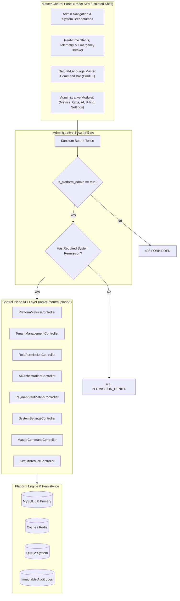

# AutoCanvas — Master Control Panel Specification
**Document ID:** ARCH-MCP-001  
**Version:** 2.0.0 (Production Master)  
**Access Classification:** Restricted — Super Administrator & Authorized Platform Staff Only  
**Root URL Route:** `/control-plane` (Frontend) / `/api/v1/control-plane/*` (Backend)  

---

## 1. System Mission & Operational Scope

The **Master Control Panel (MCP)** is the centralized cockpit through which the platform owner, system architects, and authorized administrative staff operate, govern, and monitor the AutoCanvas SaaS ecosystem.

It is completely decoupled from tenant-facing business logic:
- Tenant users have no awareness of or access to Control Plane endpoints.
- Access requires a user account with `is_platform_admin = true` and verifiable membership in the custom RBAC permission registry.
- Every read and mutation within the Control Plane is immutably recorded in `system_change_logs` and `admin_audit_logs`.

---

## 2. Architectural Blueprint



---

## 3. Core Administrative Modules

### 3.1 Master Telemetry & Operational Dashboard
- **Financial Metrics:** Monthly Recurring Revenue (MRR), Annual Run Rate (ARR), Average Revenue Per User (ARPU), Churn Rate, and Pending Payment Volume.
- **Tenant Metrics:** Total Registered Organizations, Active Workspaces, Total Brands, Daily Active Users (DAU).
- **Engine Telemetry:** 24-hour Social Publishing Throughput, Success/Failure Percentage, Active Queue Backlog Depth, Dead Letter Queue (DLQ) count.
- **AI Infrastructure Telemetry:** Total Input/Output Tokens consumed across Gemini, Claude, and OpenAI; Gross AI API cost in USD; Average response latency.

### 3.2 Tenant & Organization Lifecycle Engine
- **Search & Filters:** Real-time search by organization name, slug, owner email, subscription tier, and operational status (`active`, `suspended`, `delinquent`).
- **Organization Deep-Dive:**
  - View member roster, brand profiles, and connected social accounts.
  - Review per-tenant resource consumption (storage used, AI spend, post count vs plan limit).
- **Lifecycle Actions:**
  - **Suspend Organization:** Instantly freezes tenant logins, revokes active Sanctum tokens, and halts scheduled publishing.
  - **Adjust Plan Entitlements:** Temporarily or permanently override limits (e.g., granting an extra brand slot or higher AI budget).
  - **Scoped Impersonation:** Generates a temporary, 15-minute read-only audit token enabling platform support staff to view the tenant dashboard exactly as the user sees it without requesting passwords.

### 3.3 Custom Role-Based Access Control (RBAC) Console
- **Permission Browser:** Complete, searchable index of all atomic system capabilities (`system.organizations.view`, `system.billing.verify`, etc.).
- **Role Builder:** Create custom administrative roles (e.g., `Support Level 1`, `Financial Auditor`, `AI Operations Specialist`) with granular checkbox assignments.
- **Staff Assignment:** Bind platform staff users to defined roles with optional expiration timestamps.

### 3.4 AI Provider & Model Routing Center
- **Provider Status:** Real-time health, quota limits, and API latency for Google Gemini 1.5, Anthropic Claude, OpenAI, and local mock providers.
- **Dynamic Task Routing:**
  - Select active model for `research_summarization` (e.g., `gemini-1.5-flash` for high-throughput cost efficiency).
  - Select active model for `creative_copywriting` (e.g., `claude-3-5-sonnet` for editorial brilliance).
  - Select active model for `quality_assurance_evaluation` (e.g., `gpt-4o-mini`).
- **Fallback Chains:** Configure automatic failover (e.g., if Anthropic API throws 529 Overloaded, route to Gemini 1.5 Pro).
- **Global AI Budget Cap:** Hard daily spending ceiling in USD; if hit, non-critical AI tasks pause while preserving scheduled publishing.

### 3.5 Local Payment & Offline Verification Queue
- **Centralized Verification Inbox:** Displays pending bKash, Nagad, and bank wire payment submissions from tenant checkouts.
- **Verification Workbench:**
  - Shows submitted Transaction ID (TrxID), claimed amount, billing period, and target invoice.
  - Staff one-click actions:
    - **Approve:** Updates invoice to `paid`, sets transaction `verified`, extends subscription `current_period_end`, and fires confirmation email.
    - **Reject:** Marks transaction `rejected`, records rejection reason, and notifies tenant billing contact.

### 3.6 Global Configuration Center & Change Auditing
- **Live Setting Editor:** Manage runtime platform variables (system maintenance mode, public registration open/closed, max upload file size, default retry count).
- **Cryptographic Settings:** Safely update third-party API client IDs and redirect URIs without redeploying code.
- **Change Audit Log:** Every configuration change displays an inline JSON visual diff of previous vs. new values with user attribution.

---

## 4. Natural-Language Master Command Interface

The Control Panel incorporates a keyboard-driven (`Cmd+K` / `Ctrl+K`) **Natural-Language Command Interface** powered by the AI Gateway:

```
[ CMD ] > Pause all publishing jobs for tenant "apex-media" due to billing dispute
-----------------------------------------------------------------------------------
Detected Intent: ACTION_PAUSE_TENANT_PUBLISHING
Resolved Target: Organization: Apex Media (ID: 01JCAR0A9Z3K1QW8E7M4D2P5XN)
Operation Tier: DESTRUCTIVE / HIGH RISK
Impact: 14 scheduled social posts will be frozen.

[ PROCEED WITH OVERRIDE ] (Click or press Enter to confirm)
```

### 4.1 Supported Command Intents
1. `ACTION_GET_METRICS`: Instant retrieval of revenue, queue depth, or AI costs.
2. `ACTION_INSPECT_TENANT`: Navigate directly to organization audit screen.
3. `ACTION_SUSPEND_TENANT`: Halt organization operations.
4. `ACTION_RESUME_TENANT`: Restore organization operations.
5. `ACTION_PAUSE_TENANT_PUBLISHING`: Freeze outbound social posts for one organization.
6. `ACTION_RESUME_TENANT_PUBLISHING`: Unfreeze outbound social posts.
7. `ACTION_VERIFY_PAYMENT`: Approve pending bKash/Nagad transaction by TrxID.
8. `ACTION_SWITCH_AI_MODEL`: Re-route task type to a different model.
9. `ACTION_CIRCUIT_BREAKER_ACTIVATE`: Global emergency pause of all automation.
10. `ACTION_CIRCUIT_BREAKER_DEACTIVATE`: Global emergency resumption.

### 4.2 Two-Stage Confirmation Protocol
Destructive commands (`SUSPEND`, `CIRCUIT_BREAKER`, `WIPE_TOKENS`) cannot execute directly via single-shot text. The backend generates a cryptographically signed, short-lived `confirmation_token` (valid 60 seconds). Execution occurs only when the operator reviews the impact summary and confirms.

---

## 5. Emergency Circuit Breakers

Positioned persistently in the top navigation bar of the Control Panel:

1. **`PAUSE_ALL_AUTOMATIONS` (Red Button):**
   - Requires two clicks or secondary password challenge.
   - Sets global setting `pause_all_automations = true`.
   - All worker queues halt job dispatch.
   - Schedulers sleep without modifying database queues.
2. **`REVOKE_ALL_SOCIAL_TOKENS` (Black Button):**
   - Used in severe upstream security incidents.
   - Flags all stored tokens as `revoked`, forcing re-authentication before any post can publish.

---
*Signed by Principal Software Architect & Lead Security Engineer*  
*AutoCanvas Platform Engineering Team*

