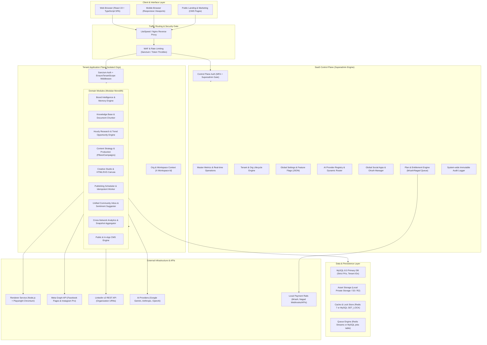
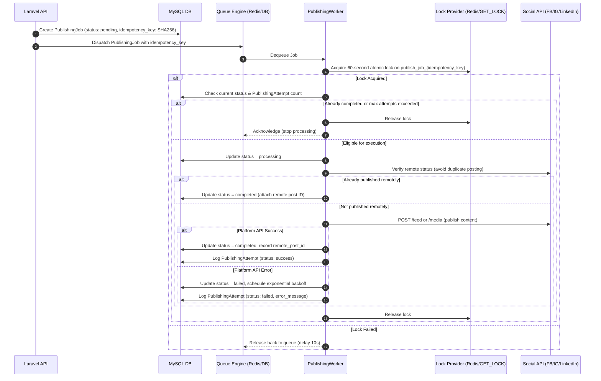

# AutoCanvas — System Architecture Specification
**Document ID:** ARCH-SYS-001  
**Version:** 2.0.0 (Production Master)  
**Status:** Approved Architectural Blueprint  
**Primary Domain:** `autocanvas.devcenterpoint.com`  

---

## 1. Architectural Philosophy & Guiding Principles

AutoCanvas is architected as an **Autonomous Social Media Operations & Brand Intelligence Platform**. Rather than a generic AI wrapper or an ephemeral social scheduler, it functions as a mission-critical operating system for brands, organizations, marketing teams, and digital agencies.

The system is built upon seven foundational architectural principles:

1. **Strict Plane Separation (Control Plane vs. Tenant Application Plane):**
   - The **SaaS Control Plane** oversees platform governance, billing, global AI model orchestration, social connector app credentials, system health telemetry, tenant lifecycle, and administrative audit logging.
   - The **Tenant Application Plane** provides isolated operational environments for organizations, workspaces, and brands to conduct research, content strategy, creative composition, publishing, community interaction, and analytics.
   - At no point may tenant operations mutate control plane infrastructure, nor may tenant users access control plane data without explicit superadmin authorization verified against a centralized, immutable Permission Registry.

2. **Modular Monolith over Distributed Microservices:**
   - To optimize operational velocity, simplify developer mental models, minimize serialization overhead, and enable cost-conscious solo-founder hosting on cPanel/shared servers, the entire core backend is organized as a cohesive **Modular Monolith** within Laravel 11/12+ (PHP 8.3).
   - Domain modules communicate via well-defined internal PHP contracts, strictly typed Data Transfer Objects (DTOs), and asynchronous Laravel Events, preventing tight coupling and facilitating seamless extraction into standalone microservices if workload scaling demands it in the future.

3. **Deterministic Creative Rendering:**
   - LLMs and image models are not trusted to render text, typography, alignment, or brand logos directly into raster images due to hallucinations, pixel distortion, and non-compliance with brand standards.
   - AI models generate structural copy and layout directives; a dedicated headless Chromium rendering service (`renderer/`) composites pixel-perfect, vector-sharp graphics via HTML5/SVG templates.

4. **Zero Fake Integrations & Cryptographic Authenticity:**
   - Simulated success responses, mock social publishing stubs, and synthetic analytics have zero place in the production runtime. All social connections must establish valid OAuth2 tokens, refresh tokens via official refresh flows, and verify publishing via platform receipt IDs (e.g., Meta Graph API ID, LinkedIn URN).
   - Stubs and mock providers are restricted exclusively to automated test suites (`Tests\TestCase`).

5. **Idempotent Queue Operations & Reconciliation:**
   - Every scheduled publish task carries a unique, deterministic `idempotency_key` (SHA-256 of `organization_id + destination_account_id + content_fingerprint + scheduled_time_utc`).
   - Prior to dispatch, the worker acquires a distributed or database-backed lock. In the event of network disruption or worker restarts, publishing status is reconciled with the remote platform API before any retry is attempted, preventing duplicate social posts.

6. **Hosting Dual-Compatibility (cPanel-First to Dedicated VPS):**
   - The platform operates natively on standard cPanel environments (Apache/LiteSpeed, MySQL 8.0, PHP 8.3 via FastCGI/PHP-FPM, single-command cron scheduler `* * * * * php artisan schedule:run`) without requiring persistent root daemons.
   - All Redis-dependent components (locks, cache, queues, rate limiters) feature automatic, drop-in database-backed fallbacks (`DB::transaction`, `GET_LOCK()`, database queue driver).
   - A single migration path allows flipping configuration to Redis 7, Supervisor worker daemons, and Docker Compose on a dedicated VPS without changing application code.

7. **Multi-Model AI Gateway with Cost Accounting:**
   - All AI interactions (text generation, copy formatting, QA evaluation, brand discovery, and vector embeddings) route through an abstracted, provider-agnostic `AIGateway`.
   - The gateway supports dynamic model routing (e.g., Gemini 1.5 Pro/Flash, Claude Sonnet 3.5, GPT-4o, GPT-4o-mini), fallback chains, input/output token counting, latency metrics, and real-time per-tenant cost attribution stored in `ai_usage_records`.

---

## 2. High-Level Architecture Topology



---

## 3. SaaS Control Plane Architecture

The SaaS Control Plane is entirely decoupled from tenant business logic, serving as the sovereign management cockpit for platform operators and system engineers.

### 3.1 Custom RBAC Permission Registry
Rather than using generic string roles, the platform employs a custom, database-backed, granular **Permission Registry**:
- Every capability is registered as a scoped dot-notation string:
  - `system.organizations.view`, `system.organizations.create`, `system.organizations.suspend`
  - `system.billing.plans.manage`, `system.billing.payments.verify`
  - `system.ai.providers.manage`, `system.ai.budgets.override`
  - `system.social.apps.configure`, `system.social.tokens.revoke`
  - `system.cms.pages.publish`, `system.cms.banners.manage`
  - `system.emergency.circuit_breaker.toggle`
- Roles (`Super Administrator`, `Platform Auditor`, `Support Specialist`, `Billing Clerk`) are dynamic aggregations of registered permissions.
- Access to any `/api/v1/control-plane/*` endpoint requires `auth:sanctum` combined with the `RequirePermission` middleware and strict checks on `users.is_platform_admin`.

### 3.2 Dual-Plane Boundary Enforcement
```
+-----------------------------------------------------------------------------------+
|                                 HTTP REQUEST                                      |
+-----------------------------------------------------------------------------------+
                                         |
                       +-----------------------------------+
                       | Is URI matching /control-plane/*? |
                       +-----------------------------------+
                                   /           \
                             YES  /             \  NO
                                 /               \
        +-----------------------------+     +-----------------------------+
        | Control Plane Gate          |     | Tenant Application Scope    |
        | - Check is_platform_admin   |     | - Require Sanctum token     |
        | - Check User Status         |     | - Resolve X-Workspace-Id    |
        | - Check Required Permission |     | - Verify Org Membership     |
        | - Bypass Tenant Global Scope|     | - Bind Current Org Context  |
        | - Log to Admin Audit Log    |     | - Apply HasTenantScope      |
        +-----------------------------+     +-----------------------------+
```

### 3.3 Global Configuration Center & Change Management
- Configuration parameters (maintenance mode, registration throttles, default AI provider, max concurrent jobs, emergency circuit breakers) are stored in a dedicated `system_settings` table.
- Settings are loaded into runtime memory and cached with immediate invalidation on mutation.
- Every setting change records the prior value, the updated value, the admin user ID, client IP, and a timestamp in `system_change_logs`.

---

## 4. Tenant Application Plane & Multi-Tenancy

### 4.1 Strict Multi-Tenancy & TenantScope
AutoCanvas uses a **Shared Database, Shared Schema with Discriminator Column (`organization_id`)** model. This provides the highest cost efficiency and simplest maintenance profile for cPanel and mid-tier VPS hosting.

- **Non-Negotiable Rule:** Every tenant-owned database table contains an `organization_id` foreign key referencing `organizations(id)` with `ON DELETE CASCADE`.
- **Global Eloquent Scope:** The `App\Core\Concerns\HasTenantScope` trait registers `TenantScope`, which intercepts every `select`, `update`, and `delete` query, appending `WHERE {table}.organization_id = '{current_org_id}'`.
- **Automatic Hydration:** During model creation, if `organization_id` is null, the trait automatically populates it from `app('current_organization_id')`.
- **Console & Worker Safety:** In CLI or background worker environments, the tenant scope only activates if `app('current_organization_id')` is explicitly injected by the executing job, preventing unauthenticated leakage across batch routines.

### 4.2 Workspace Hierarchy
```
Organization (Root Legal Entity / Billing Subject / Owner)
   │
   ├── Workspace A (Default: e.g., "Main Operations")
   │      ├── Brand 1 (Identity, Knowledge Base, Pillars, Memory)
   │      └── Brand 2
   │
   └── Workspace B (e.g., "Agency Client: Nike EMEA")
          └── Brand 3
```
- Users hold an `OrganizationMember` role (`owner`, `admin`, `editor`, `viewer`, `billing`).
- Workspace access can be restricted to specific team members via `WorkspaceMember` records.
- Switching active workspaces is executed through a verified POST `/api/v1/auth/switch-workspace` request that checks organization membership before updating the user's active context.

---

## 5. Asynchronous Engine & Job Processing

### 5.1 Publishing Job Lifecycle & Idempotency
Publishing to social networks is a high-risk asynchronous operation subject to network timeouts, rate limit bans, and transient platform errors. AutoCanvas executes social publishing through an immutable 7-step lifecycle:



### 5.2 Emergency Circuit Breakers
The platform features two distinct emergency circuit breaker levels:
1. **Global Circuit Breaker (`PAUSE_ALL_AUTOMATIONS`):** Activated by superadmins in the Master Control Panel or via the standalone CLI recovery tool. Immediately causes all worker loops to halt job consumption and return jobs to the queue.
2. **Tenant Circuit Breaker (`PAUSE_ORGANIZATION_AUTOMATIONS`):** Activated by organization owners or administrators in under two clicks. Suspends hourly research cycles, draft auto-generation, and scheduled post dispatch for that tenant without deleting any scheduled jobs or data.

---

## 6. Headless Chromium Rendering Architecture

To deliver pixel-perfect, deterministic creative assets, AutoCanvas operates a dedicated rendering daemon located in `renderer/`:

- **Runtime:** Node.js (v20+) + Express + Playwright Chromium.
- **Workflow:**
  1. Laravel backend posts a layout directive, color tokens, font references, and text strings to `http://127.0.0.1:3001/render`.
  2. The Express server validates the payload against `renderer/src/schemas.ts` (Zod schema).
  3. Playwright uses a pre-warmed, recycled browser page context to load the template SVG/HTML.
  4. Web fonts (Geist Sans, Geist Mono, Noto Sans Bengali) are injected via local base64/data URIs to prevent external CDN render latency.
  5. The canvas is rendered at 2x pixel density (`deviceScaleFactor: 2`) and captured as a pristine PNG or JPEG buffer.
  6. The buffer is returned directly or streamed into object storage (`storage/app/public/creatives/` or S3/Cloudflare R2).
- **cPanel Fallback Mode:** When Node.js daemon support is unavailable on restricted cPanel tiers, the rendering subsystem falls back to invoking a headless CLI script or calling an external rendering endpoint configured in `.env` (`RENDERER_EXTERNAL_URL`).

---

## 7. Natural-Language Master Command Interface

The Master Control Panel includes a **Natural-Language Command Interface** designed for system operators. Rather than allowing raw LLM execution of arbitrary SQL or code, it utilizes a **Deterministic Action Intent Engine**:

1. **Intent Classification:** The operator's natural language input (e.g., *"Suspend tenant Acme Corp and pause their publishing jobs"*) is analyzed by the AI Gateway using a strict JSON schema.
2. **Action Identification:** The gateway resolves the query into one of 18 pre-registered system actions (e.g., `ACTION_SUSPEND_TENANT`, `ACTION_PAUSE_QUEUE`, `ACTION_GENERATE_REVENUE_REPORT`).
3. **Parameter Extraction & Typing:** Parameters (`organization_slug: "acme-corp"`) are strictly typed and verified against database existence.
4. **Safety & Confirmation Gate:** If the resolved action is categorized as destructive (mutates data, suspends tenants, or clears queues), the system requires an explicit secondary confirmation step displaying the exact operational blast radius.
5. **Audit Logging:** Every command execution, whether successful or rejected, is permanently recorded in `control_plane_command_logs`.

---

## 8. Technology Stack Verification Matrix

| Component | Selected Technology | Version | Rationale & Deployment Path |
|---|---|---|---|
| **Backend Framework** | Laravel | 13.x (PHP 8.3+) | Production-grade, secure, modular monolith, Sanctum auth, native jobs/schedules. |
| **Relational Database** | MySQL | 8.0+ | Strict foreign keys, JSON columns, full-text indexing, universal cPanel & VPS support. |
| **Cache & Queue Driver** | Redis / Database Dual-Mode | Redis 7+ / MySQL | Redis for VPS high-throughput; MySQL tables for zero-daemon cPanel compatibility. |
| **Frontend Framework** | React | 19.x + Vite 8 | High-performance SPA, strict TypeScript typing, modern module federation. |
| **Styling & Tokens** | Tailwind CSS + CSS Variables | 4.x | Zero-hex policy, dark/light token architecture, WCAG 2.2 AA compliant. |
| **Interactive Canvas** | React Konva | Latest MIT | Safe commercial licensing (avoiding tldraw AGPL risk), full layer control. |
| **Publishing Calendar** | FullCalendar Core | 6.x MIT | High-performance month/week scheduling, keyboard accessible. |
| **Headless Renderer** | Node.js + Playwright | Node 20 / Chromium | Deterministic, vector-sharp SVG/HTML to image rendering without AI distortion. |
| **AI Gateway** | Custom Provider Router | Internal | Supports Google Gemini 1.5, Claude Sonnet 3.5, GPT-4o, and local mock fallback. |
| **Payment Gateways** | bKash, Nagad, Manual Queue | Direct API / Merchant | Tailored local payment rails in South Asia with idempotent verification queues. |

---
*Signed by Principal Software Architect & Technical Lead*  
*AutoCanvas Platform Engineering Team*

