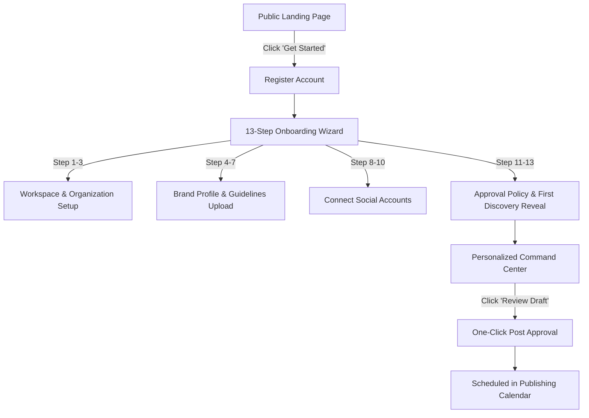

# AutoCanvas — Core User Journeys

> This document maps the primary end-to-end user journeys for the four key platform personas: Business Owner, Social Media Manager, Agency Operator, and Enterprise Administrator.

---

## 1. Persona Archetypes

| Persona | Primary Goal | Key Workspaces | Complexity Preference |
|---|---|---|---|
| **Business Owner** | Set up brand once, review drafts quickly, view reach results | Onboarding, Command Center, Calendar | Comfortable, Core Tier |
| **Social Media Manager** | Research trending opportunities, write multi-platform variants, design graphics | Research Radar, Content Studio, Creative Studio | Comfortable, Pro Tier |
| **Agency Operator** | Switch between client brands, assign team roles, approve bulk schedules | Brand Switcher, Calendar, Team Settings, Audit | Compact, Pro Tier |
| **Enterprise Admin** | Monitor automated worker health, manage token budgets, control killswitch | Command Center, Audit Log, Billing, Platform Admin | Compact, Pro Tier |

---

## 2. Journey 1: The First-Time Business Owner (0 to First Scheduled Post)

### Steps:
1. **Discovery:** User arrives at the public marketing page, sees clear editorial proof of deterministic rendering.
2. **Registration:** Minimal credentials input (Name, Work Email, Password).
3. **Progressive Setup:** The 13-step wizard guides the user without cognitive overload. Progress is saved continuously.
4. **Instant Value:** At Step 13, the AI synthesizes initial brand guidelines and reveals 3 curated post ideas ready for one-click approval.
5. **Operational Assurance:** The user sees the upcoming slot booked on the Publishing Calendar with exact account timezone.

---

## 3. Journey 2: The Social Media Manager (Opportunity to Multi-Platform Campaign)

```mermaid
flowchart LR
    A[Trend Radar] -->|High Confidence Signal| B[Research Detail]
    B -->|Click 'Generate Post'| C[Content Studio]
    C -->|AI Prompt Routing| D[Multi-Platform Copy Variants]
    D -->|Click 'Open Creative Canvas'| E[Creative Studio]
    E -->|Select Preset & Adjust Copy| F[Deterministic SVG/HTML]
    F -->|Send to Approval Queue| G[Publishing Calendar Slot]
```

### Steps:
1. **Signal Discovery:** Manager opens `Research & Trend Discovery Radar`, filters by `High Confidence` signals.
2. **Bridge to Content:** Clicks "Generate Post from Opportunity". The signal's citations and key takeaways transfer automatically into `ContentStudio`.
3. **Multi-Channel Adaptation:** AI generates tailored variants:
   - *LinkedIn:* Structured paragraphs with professional insight and 3 relevant hashtags.
   - *Instagram:* Visually engaging hook, formatted line-breaks, expanded hashtag block.
   - *Facebook:* Conversational narrative with link preview card.
4. **Visual Layout:** Clicks "Launch React Konva Canvas". Brand vector colors and typography populate instantly into the 1080×1080 template.
5. **Scheduling:** Assigns publication time slot and sets status to `Scheduled`.

---

## 4. Journey 3: The Agency Operator (Cross-Brand Morning Review)

1. **Workspace Switcher:** Operator uses `⌘K` or the top sidebar dropdown to switch between Brand Alpha and Brand Beta.
2. **Publishing Calendar Inspection:** Views the monthly grid across all connected accounts. Filters by `Failed` or `Pending Approval` to catch blockers.
3. **Bulk Reschedule:** Uses the keyboard-accessible reschedule drawer to move queued posts away from major holiday conflicts.
4. **Emergency Pause:** If a brand crisis emerges, the operator triggers `Emergency Pause` in 2 clicks, halting scheduled jobs for that specific brand without deleting work.

