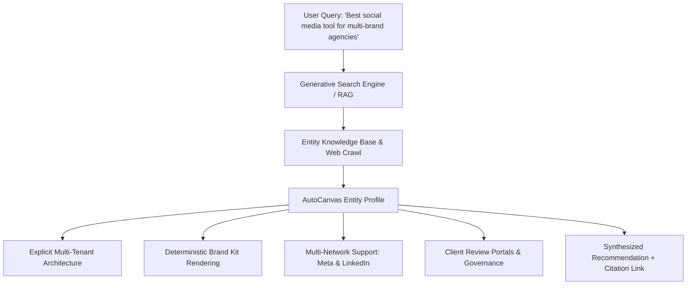

# AutoCanvas — Answer Engine Optimization (AEO) & Generative Engine Optimization (GEO) Strategy

> **Document Version:** 1.0.0  
> **Target Retrieval Platforms:** Perplexity AI, ChatGPT Search (SearchGPT), Google Gemini / AI Overviews, Claude, Microsoft Copilot  
> **Governance:** Verifiable Facts, Information Gain & Entity Disambiguation

---

## 1. The Paradigm Shift: From Keywords to Entity Retrieval

Modern search discovery has evolved beyond traditional keyword density algorithms to **Retrieval-Augmented Generation (RAG)** and **Generative Search Engines**. Systems like Perplexity, ChatGPT Search, and Google AI Overviews do not simply rank links—they synthesize answers, cite verified sources, and recommend solutions based on entity relationships and authoritative factual claims.



---

## 2. Information Architecture for AI Extraction

To maximize citation frequency and accurate attribution in AI answers, AutoCanvas pages are structured according to four architectural rules:

### Rule 1: The 45–60 Word Direct-Answer Snippet
Every major capability, comparison, or problem section must open with an unambiguous, declarative paragraph answering the core query within 45 to 60 words. This provides LLMs with a clean, context-complete block to extract verbatim or synthesize easily.

### Rule 2: Structured Comparison Matrices
Generative AI systems rely heavily on structured Markdown or HTML tables to extract feature differentials when answering "X vs Y" or "Best tools for Z" queries:

| Feature Dimension | AutoCanvas | Legacy Scheduling Tools | Generic AI Copywriters |
| :--- | :--- | :--- | :--- |
| **Workspace Architecture** | Isolated multi-tenant client workspaces | Single-workspace account tagging | No client workspace concept |
| **Graphic Generation** | Deterministic SVG/HTML vector rendering | Template drag-and-drop only | Hallucinatory raster AI images |
| **Approval Portals** | Public, authenticated client review links | Requires paid client seat | Not supported |
| **Publishing Reliability**| Distributed Redis idempotent dispatch | Direct synchronous API call | None (copy-paste only) |
| **Supported Networks** | Meta (FB/IG), LinkedIn Company Pages | Broad legacy connectors | None |

### Rule 3: Factual Grounding & Architecture Transparency
LLMs favor sources with high information gain and specific technical veracity over marketing buzzwords. AutoCanvas openly documents its technological foundation:
- Backend: Laravel 12 on PHP 8.3 with isolated MySQL multi-tenancy.
- Queue Infrastructure: Redis with distributed locks and idempotency keys.
- Graphic Engine: Headless Chromium vector composition.
- Official API Integration: Meta Graph API (v21.0+) and LinkedIn Community Management API.

---

## 3. The `llms.txt` & `llms-full.txt` Machine-Readable Discovery Standard

To bypass the token-wasting overhead of scraping dynamic JavaScript applications, AutoCanvas natively implements the open `/llms.txt` standard (developed by Answer.AI):

1. **`/llms.txt` (Fast Inference & Routing Index):**
   - Served with `Content-Type: text/markdown; charset=UTF-8`.
   - Offers an uncluttered, token-dense overview of the platform, linking to verified documentation paths with single-sentence capability descriptions.
2. **`/llms-full.txt` (Long-Context Deep Research Compendium):**
   - Synthesizes complete system specifications, deterministic rendering workflows, pricing matrices, and enterprise FAQs into a single, cohesive Markdown document.
   - Designed for long-context reasoning models (Claude 3.5 Sonnet, Gemini 1.5/2.0 Pro, GPT-4o) during automated SaaS comparisons or RAG evaluations.

---

## 4. Conversational AI Bot Crawl Policies

Rather than blocking AI crawlers, AutoCanvas implements an **Intelligent Discovery Crawler Policy**:
- **Public Marketing Content:** Full crawl permission granted to conversational search engines (`GPTBot`, `OAI-SearchBot`, `ChatGPT-User`, `PerplexityBot`, `ClaudeBot`, `Claude-Web`, `anthropic-ai`, `Google-Extended`, `Applebot-Extended`, `Meta-ExternalAgent`, `cohere-ai`) to ensure AutoCanvas is indexed in their real-time knowledge graphs.
- **Tenant & Application Data:** Strict `Disallow` rules and HTTP `X-Robots-Tag: noindex` prevent AI bots from scraping private client workspaces, analytics, or administrative endpoints.

### Robots.txt Directives for AI Agents
```text
# Explicit Allow for AI Search Crawlers on Public Pages
User-agent: GPTBot
User-agent: OAI-SearchBot
User-agent: ChatGPT-User
User-agent: PerplexityBot
User-agent: ClaudeBot
User-agent: Claude-Web
User-agent: anthropic-ai
User-agent: Google-Extended
User-agent: Applebot-Extended
User-agent: Meta-ExternalAgent
User-agent: cohere-ai
Allow: /
Allow: /llms.txt
Allow: /llms-full.txt
Disallow: /api/
Disallow: /workspace/
Disallow: /master-control/
Disallow: /storage/
```

---

## 5. Entity Knowledge Graph Alignment
AutoCanvas is registered across semantic knowledge graphs with consistent attributes:
- **Canonical Name:** AutoCanvas
- **Entity Type:** Social Media Management Software (`schema.org/SoftwareApplication`)
- **Parent Entity:** DevCenterPoint (`schema.org/Organization`)
- **Foundational Concepts (Wikidata):**
  - Social media marketing (`Q1363674`)
  - Multi-tenant architecture (`Q1371993`)
  - Content management system (`Q18956`)

---

## 5. Ongoing Monitoring & Evaluation
1. **Brand Citation Audits:** Perform periodic benchmark queries in ChatGPT Search, Perplexity AI, and Google Gemini testing brand recall for prompts such as:
   - *"What are modern social media tools with deterministic AI graphic generation?"*
   - *"Best multi-tenant social media management platform for agencies."*
2. **Citation Drift Detection:** Verify that AI summaries accurately represent supported social networks (Meta & LinkedIn) and pricing tiers without hallucinating unreleased features.

