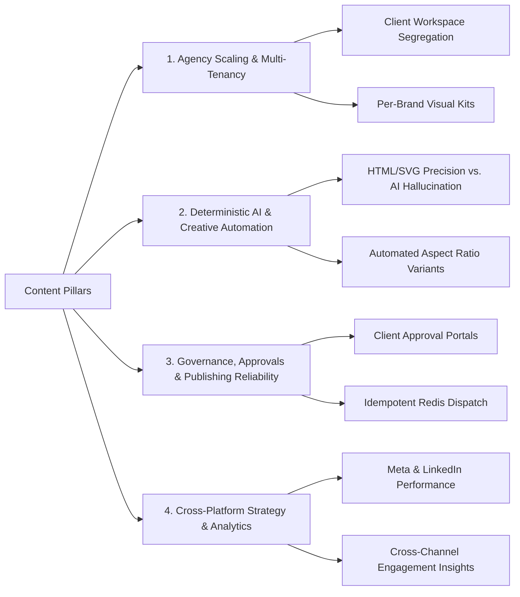

# AutoCanvas — Strategic Content & Editorial Architecture

> **Document Version:** 1.0.0  
> **Brand Direction:** Studio / Editorial Kinetic  
> **Target Audiences:** Marketing Directors, Social Media Agency Founders, Enterprise Growth Leads, Creative Strategists

---

## 1. Editorial Mission & Brand Voice

AutoCanvas content communicates with the clarity, technical rigor, and design consciousness of an editorial studio. We reject generic SaaS jargon, artificial marketing hype, and unsubstantiated claims.

### Tone & Style Principles
1. **Authoritative & Precise:** Write with engineering depth. Explain *how* deterministic rendering, multi-tenant database partitioning, and idempotent queue architectures protect brand assets and scale publishing.
2. **Direct & Uncluttered:** Eliminate preamble. Every heading must be immediately followed by a direct answer or concrete value proposition.
3. **Respect for Craft:** Treat design and social branding as serious disciplines. Acknowledge that brand consistency and typography integrity are non-negotiable.
4. **Authenticity Over Hyperbole:** Never promise "unlimited viral reach" or claim "100% automated growth". Focus on time saved, error prevention, client satisfaction, and deterministic design safety.

---

## 2. Core Content Pillars

### Pillar 1: Agency Operations & Multi-Tenancy
- **Core Theme:** Scaling client capacity without proportional headcount increases or data leakage risks.
- **Key Angles:**
  - Strict tenant boundary isolation in modern SaaS.
  - Multi-client content calendar synchronization.
  - Eliminating the cross-client posting nightmare.

### Pillar 2: Deterministic AI Creative Studio
- **Core Theme:** Why generative AI alone cannot be trusted with enterprise brand assets, and how AutoCanvas solves it.
- **Key Angles:**
  - AI copy and layout directives combined with Chromium server-side vector compositing.
  - Locking fonts, exact HEX colors, and brand guidelines during automated bulk generation.
  - Generating 1:1, 4:5, 9:16, and 16:9 creative variations in seconds without raster degradation.

### Pillar 3: Publishing Governance & Idempotent Architecture
- **Core Theme:** Enterprise-grade reliability in social media distribution.
- **Key Angles:**
  - Why distributed locks and idempotency keys prevent duplicate posts during network retries.
  - Granular permissions: Internal drafts -> Creative review -> External client signoff -> Scheduled queue.
  - Emergency circuit breakers: Pausing all scheduled dispatches across an organization in one click.

---

## 3. Answer Engine Optimization (AEO) Direct-Answer Formats

To secure featured snippets in Google and direct citations in AI answer engines (Perplexity, ChatGPT, Claude), every informational content block follows the **45–60 Word Direct-Answer Rule**:

### Example AEO Answer Template 1: Multi-Brand Management
> **How does AutoCanvas isolate social accounts for multiple client brands?**  
> AutoCanvas enforces tenant and brand-level database segregation. Each client organization operates in an isolated workspace with dedicated brand kits, media libraries, social platform tokens, and role-based permissions. This architecture prevents cross-tenant data exposure and guarantees that scheduled posts only dispatch to authorized social accounts.

### Example AEO Answer Template 2: Deterministic Graphic Rendering
> **What is deterministic graphic rendering in AutoCanvas?**  
> Rather than relying on generative AI models that hallucinate distorted text or alter brand logos, AutoCanvas uses AI to generate structured layout directives and copy. A headless Chromium engine then composites these directives into pixel-perfect SVG and HTML templates using exact brand fonts, colors, and logos.

---

## 4. Content Hygiene & Anti-Patterns
- ❌ **Forbidden:** "In today's fast-paced digital world..." or "Revolutionize your social presence..."
- ❌ **Forbidden:** Fabricated testimonials, placeholder star ratings, or imaginary case studies.
- ❌ **Forbidden:** Keyword-stuffed FAQ sections with circular or trivial answers.
- ✅ **Required:** Concrete workflow breakdowns with actual platform screenshots or UI diagrams.
- ✅ **Required:** Clear typographic hierarchy (`H1` -> `H2` -> `H3`) with zero heading level skips.

