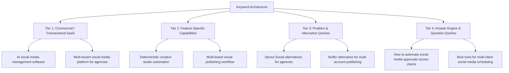

# AutoCanvas — Keyword Strategy & Search Intent Mapping

> **Strategy Version:** 1.0.0  
> **Target Audience:** Digital Marketing Agencies, Multi-Brand Enterprises, Social Media Teams, SaaS Marketers  
> **Framework:** Semantic Topical Clustering & Search Intent Alignment

---

## 1. Keyword Taxonomy & Intent Framework

AutoCanvas targets high-intent commercial and transactional queries in the enterprise and agency social media automation space, balanced with problem-aware informational searches.



---

## 2. Comprehensive Keyword Matrix

### Category A: Core Primary Commercial Keywords
| Keyword Phrase | Search Intent | Target URL | Content Angle |
| :--- | :--- | :--- | :--- |
| `AI social media management software` | Commercial Investigation | `/` | All-in-one AI platform for content creation, scheduling & analytics. |
| `multi-brand social media publishing platform` | Transactional | `/` | Scalable publishing engine with multi-brand workspaces & asset separation. |
| `agency social media management tool` | Commercial | `/solutions/agencies` | Multi-tenant workspaces with client approval workflows and white-labeling. |
| `autonomous social media content creation` | Commercial | `/features/ai-studio` | AI generation paired with deterministic brand design system enforcement. |

### Category B: Secondary & Capability Keywords
| Keyword Phrase | Search Intent | Target Feature Area |
| :--- | :--- | :--- |
| `social media content approval workflow` | Problem / Commercial | Governance & Approvals engine |
| `unified social inbox for multiple accounts` | Solution Seeking | Social Inbox (Phase 6) |
| `automated social media scheduling tool` | Transactional | Smart Content Calendar |
| `multi-platform social media publisher` | Commercial | Meta (FB/IG) & LinkedIn Connector |
| `deterministic AI graphic generator` | Technical / Evaluative | Creative Studio (Chromium rendering) |

### Category C: High-Volume Long-Tail & Problem Queries
| Long-Tail Query | User Need | Solution Narrative |
| :--- | :--- | :--- |
| `how to manage social media for 20 clients without mixing accounts` | Agency scaling friction | Highlight AutoCanvas multi-tenant organization isolation and brand workspaces. |
| `social media scheduling tool with client approval portal` | Client friction & compliance | Explain one-click external review links without requiring client logins. |
| `automate facebook instagram and linkedin posts in one dashboard` | Platform fragmentation | Single-dispatch publishing with per-platform aspect ratio & caption tailoring. |
| `prevent AI social graphics from distorting logos and brand typography` | Design inconsistency | Deterministic rendering: HTML/SVG templates over raw generative pixels. |

### Category D: Competitor Comparison & Alternative Keywords
| Search Query | Intent | Positioning Nuance |
| :--- | :--- | :--- |
| `Hootsuite alternative for marketing agencies` | High-Value Commercial | Lower per-seat penalty, native multi-tenant workspaces, superior modern UX. |
| `Sprout Social alternatives for small agencies` | Commercial | Enterprise-grade approval workflows without prohibitive enterprise seat licensing. |
| `Later vs Buffer vs AutoCanvas for multi-brand teams` | Evaluative Comparison | Autonomous scheduling combined with creative studio design system governance. |

---

## 3. Topical Cluster Architecture

```
[Cluster 1: Multi-Tenant Agency Operations]
  ├── Core Page: / (Homepage Agency Focus)
  ├── Sub-Topics:
  │    ├── Client Workspace Isolation
  │    ├── Role-Based Access Control (RBAC)
  │    └── Multi-Client Publishing Governance

[Cluster 2: Deterministic AI Creative Studio]
  ├── Core Page: /features/creative-studio
  ├── Sub-Topics:
  │    ├── Brand Design Token Enforcement
  │    ├── Pixel-Perfect SVG/HTML Composite Rendering
  │    └── AI Caption & Hashtag Generation

[Cluster 3: Multi-Platform Publishing & Scheduling]
  ├── Core Page: /features/publishing-calendar
  ├── Sub-Topics:
  │    ├── Meta (Facebook Pages & Instagram Professional)
  │    ├── LinkedIn Company Pages Publishing
  │    └── Distributed Redis Idempotent Queue Dispatch
```

---

## 4. Implementation Guidelines
1. **Keyword Cannibalization Prevention:** Each primary keyword cluster is assigned to one canonical page. Variations are resolved to their parent cluster.
2. **Natural Semantic Density:** Keywords must integrate organically into benefit-driven, authentic copy without mechanical keyword stuffing.
3. **Intent-Aligned Calls-to-Action (CTAs):**
   - Informational pages CTA: "Explore Features" / "Read Documentation".
   - Commercial pages CTA: "Start Free Trial" / "Book Agency Demo".

