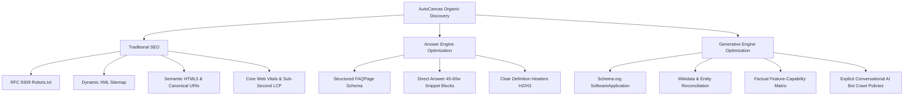

# AutoCanvas — Master SEO, AEO & GEO Discovery Architecture

> **Document Version:** 1.0.0  
> **Target Production URL:** `https://autocanvas.devcenterpoint.com`  
> **Framework Base:** `@devcenterpoint/everything-seo` (B2B SaaS Preset)  
> **Classification:** Architectural Blueprint & Public Discovery Engine

---

## 1. Executive Summary & Philosophy

AutoCanvas is an enterprise-grade, multi-tenant social media management platform engineered for agencies, brand teams, and social media creators. The organic discovery system is architected as an engineering-driven pillar designed to establish topical authority, programmatic visibility, answer-engine citability, and generative AI search recommendation.

Our discovery architecture is governed by four core tenets:
1. **Search Surface Neutrality:** Seamless optimization across traditional search (Google, Bing), conversational answer engines (Perplexity AI, ChatGPT Search, Claude), and generative summaries (Google AI Overviews).
2. **Absolute Multi-Tenant Boundary Protection:** Rigorous isolation between public marketing pages and private workspace/control-plane routes. Zero accidental indexation of customer metrics, draft campaigns, or administrative tools.
3. **Hybrid Pre-Injection Architecture:** High-performance, zero-Node server runtime compatibility for cPanel shared hosting. Server-side pre-injection of meta tags and Schema.org JSON-LD into the HTML entrypoint on initial GET, followed by dynamic client-side DOM reconciliation via React 19.
4. **Data Authenticity & Factual Precision:** Elimination of fabricated benchmarks, fake customer counters, or artificial review schema. All structured knowledge reflects verifiable product capabilities.

---

## 2. Multi-Engine Discovery Triad

### A. Traditional Search Engines (Google, Bing, Yahoo, DuckDuckGo)
- **Crawl Efficiency:** Streamlined XML sitemap (`/sitemap.xml`) updated on content modifications, linked explicitly in `/robots.txt`.
- **Indexing Directives:** Canonical URLs resolving to the HTTPS apex domain, preventing duplicate query string fragmentation.
- **Semantic Structure:** Single `<h1>` per view, logically nested `<h2>` and `<h3>` tags, and descriptive `aria-label` / `alt` attributes on interactive elements and images.

### B. Answer Engine Optimization (AEO)
- **Direct Answer Ingestion:** Formats key product answers in 40–60 word declarative paragraphs placed directly under interrogative `<h2>` headings (e.g., *"How does AutoCanvas automate multi-brand social media publishing?"*).
- **FAQ Modeling:** Machine-readable `FAQPage` JSON-LD paired with accessible HTML `
`/`
` accordions to achieve Rich Results and Voice Assistant answer capture.

### C. Generative Engine Optimization (GEO)
- **Entity Disambiguation:** Defining AutoCanvas as a `SoftwareApplication` within the `Social Media Management Software` class, linked to external knowledge graphs via `sameAs` attributes.
- **AI Bot Crawler Policies:** Explicitly permitting verified AI retrieval bots (`GPTBot`, `PerplexityBot`, `ClaudeBot`, `Google-Extended`) on public marketing routes, while forbidding access to `/workspace/*`, `/master-control/*`, and `/api/*`.

---

## 3. Rendering & Delivery Architecture (cPanel Zero-Node Deployment)

AutoCanvas utilizes a Single Page Application (SPA) built with React 19 and Vite, deployed on a production cPanel environment served by Apache/LiteSpeed and Laravel 12. Because cPanel shared hosting typically lacks persistent Node.js SSR daemons, we employ a **Hybrid Pre-Injection Architecture**:

1. **Initial HTTP GET Request:**
   - The web server directs root and public URL requests through Laravel’s `routes/web.php`.
   - Laravel checks the public CMS cache (`autocanvas:cms:public_data`) for the active `seo` block.
   - Laravel dynamically injects title, description, canonical link, OpenGraph metadata, and Schema.org JSON-LD directly into the `<head>` of the compiled `backend/public/index.html` template before returning the HTML stream.
   - Crawlers (Googlebot, Bingbot, GPTBot) receive fully rendered, authoritative metadata without needing JavaScript execution.

2. **Client-Side SPA Hydration:**
   - React 19 mounts client-side. The custom hook `useDocumentHead` manages document metadata during internal route changes (`/pricing`, `/docs`, `/features`), dynamically syncing `<title>`, `<meta>`, and canonical `<link>` tags.

---

## 4. Security & Tenant Data Isolation Matrix

| Route Pattern | Classification | Indexing Policy | Directives Enforced |
| :--- | :--- | :--- | :--- |
| `/` | Public Marketing | **Indexable** | `robots: index, follow`, in `sitemap.xml` |
| `/pricing` | Public Marketing | **Indexable** | `robots: index, follow`, in `sitemap.xml` |
| `/features/*` | Public Marketing | **Indexable** | `robots: index, follow`, in `sitemap.xml` |
| `/docs/*` | Public Documentation | **Indexable** | `robots: index, follow`, in `sitemap.xml` |
| `/workspace/*` | Private Tenant App | **Strict Noindex** | `robots.txt Disallow`, `X-Robots-Tag: noindex, nofollow, noarchive` |
| `/master-control/*` | Admin Control Plane | **Strict Noindex** | `robots.txt Disallow`, `X-Robots-Tag: noindex, nofollow, noarchive` |
| `/api/*` | API Endpoints | **Strict Noindex** | `robots.txt Disallow`, `X-Robots-Tag: noindex, nofollow, noarchive` |
| `/storage/*` | Raw Asset Bucket | **Strict Noindex** | `robots.txt Disallow` |

---

## 5. Master Control Governance Integration

Platform administrators can configure global SEO settings directly through the Master Control Panel:
- Global Meta Title & Description overrides.
- Social Sharing OpenGraph & Twitter Card image URIs.
- Canonical domain configuration.
- Real-time sitemap regeneration and cache invalidation.
- Direct links to validate `/robots.txt` and `/sitemap.xml`.

