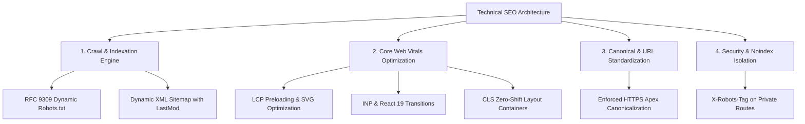
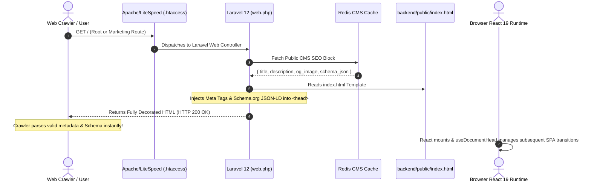

# AutoCanvas — Technical SEO, Core Web Vitals & Server Performance Architecture

> **Document Version:** 1.0.0  
> **Production Target:** `https://autocanvas.devcenterpoint.com`  
> **Host Environment:** Apache / LiteSpeed (cPanel) + PHP 8.3 / Laravel 12 + Vite / React 19

---

## 1. Technical SEO Core Principles

Technical SEO provides the resilient foundation ensuring search engines, web crawlers, and AI spiders can crawl, render, index, and evaluate AutoCanvas without friction, delays, or security leaks.



---

## 2. Hybrid Pre-Injection Architecture (Zero-Node SSR Alternative)

Traditional Single-Page Applications (SPAs) often suffer indexation penalties because search engine bots (especially non-Google crawlers like Bing, Baidu, and LLM web crawlers) may not execute client-side JavaScript immediately or reliably.

Because AutoCanvas deploys to a cPanel shared hosting environment without a Node.js SSR background process, we implement **Hybrid Pre-Injection**:



---

## 3. Core Web Vitals (CWV) Engineering Standards

AutoCanvas adheres to the highest tier of web performance benchmarks:

### A. Largest Contentful Paint (LCP) — Target < 1.2s
- **Font Optimization:** System and modern web fonts preloaded with `font-display: swap` to prevent Flash of Invisible Text (FOIT).
- **Hero Graphic Compositing:** High-priority hero visuals use lightweight inline vector SVGs or optimized WebP formats with explicit `width` and `height` dimensions.
- **HTTP/2 & Brotli/Gzip Compression:** Enabled at the web server layer (`.htaccess`) for all text-based assets (`.js`, `.css`, `.json`, `.svg`).

### B. Interaction to Next Paint (INP) — Target < 100ms
- **React 19 Concurrency:** Long rendering updates are scheduled via React transitions (`useTransition`) or non-blocking event handlers.
- **Modular Code Splitting:** Vite bundle splitting isolates third-party libraries (Lucide icons, vendor modules) so marketing landing pages only download essential scripts.

### C. Cumulative Layout Shift (CLS) — Target < 0.05
- **Dimension Reservations:** Every card, hero mock-up, video container, and image wrapper declares explicit CSS aspect ratios (`aspect-video`, `min-h-[...]`) to prevent layout jumping as assets load.
- **Modal & Overlay Isolation:** Auth modals and slide-out drawers render in portals detached from the primary document flow.

---

## 4. URL Canonicalization & Redirect Rules

1. **Protocol & Host Enforced:**
   - All HTTP traffic automatically 301-redirects to `https://autocanvas.devcenterpoint.com`.
   - Trailing slashes are normalized to prevent duplicate content variations.
2. **Canonical Link Directive:**
   - Injected in every `<head>` tag:
     ```html
     <link rel="canonical" href="https://autocanvas.devcenterpoint.com/" />
     ```
3. **Query Parameter Disregard:**
   - Marketing campaign tags (`utm_source`, `utm_medium`, `ref`) are stripped from canonical references to concentrate domain authority onto the primary URL.

---

## 5. Security & Indexation Isolation Headers

To prevent private tenant workspace screens or internal API responses from leaking into public search engine indexes:

```http
HTTP/1.1 200 OK
Content-Type: application/json
X-Robots-Tag: noindex, nofollow, noarchive
X-Content-Type-Options: nosniff
X-Frame-Options: SAMEORIGIN
Referrer-Policy: strict-origin-when-cross-origin
```

Enforced globally on:
- `/api/*` (All REST API routes)
- `/master-control/*` (All Master Control Plane views)
- `/workspace/*` (All tenant workspaces and dashboard views)

